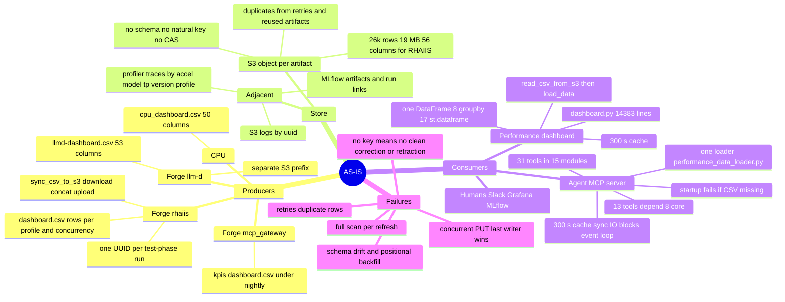
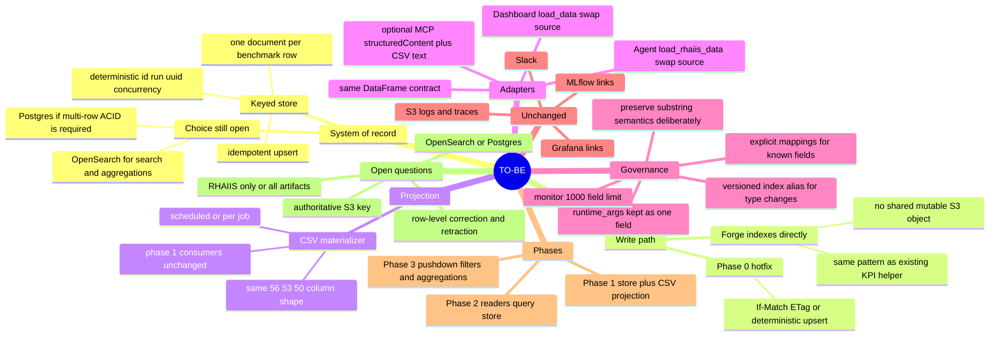

# CSV → OpenSearch: Grounded As-Is / To-Be

Research pass for the 2026-11-04 PSAP-Automation/Tooling Unification Sync.
Sources: meeting transcript/notes, `/Users/aansharm/forge`,
`/Users/aansharm/AI-Analysis-Agent`, `/Users/aansharm/performance-dashboard`,
and the primary OpenSearch/AWS/MCP documentation cited below.

## What the play actually is

This is **consolidation, not adoption**. Forge already has the OpenSearch
client, the `opensearch-py` extra, the `forge-kpis` index name, and a
deterministic-ID KPI writer/reader helper at
`projects/caliper/engine/kpi/import_export.py`. The helper is not wired into the
main pipeline (`export_kpis_to_index` has no caller; the CLI uses the import
path), so the pattern is in-tree but not yet a production system of record.

The real fault line is the **write path**, not query capability:

- `sync_csv_to_s3` does download → concat → upload on one S3 key.
- AWS resolves concurrent PUTs last-writer-wins; there is no atomic append.
- The live CSV already contains duplicate natural-key groups because nothing
  dedups.
- Both consumers already funnel through one loader each, so an adapter that
  returns the same DataFrame is far cheaper than the meeting assumed.
- OpenSearch can do the reads, but it introduces schema-governance and
  multi-document-ACID costs that must be designed, not assumed away.

At **26,024 rows / 19 MB / 56 columns**, scale is not the reason to migrate.
Keying, concurrency safety, and field-level query semantics are.

**The store choice is not settled.** The meeting leaned OpenSearch because an
instance is available and Alex knows it, but the evidence does not establish
OpenSearch as the better system of record for this workload. The data is small
and tabular, the queries are filters/substring/top-N/groupby, and corrections
need multi-row atomicity. **Postgres is the lower-risk default; OpenSearch is
justified as a search/analytics index if full-text/fuzzy search or much larger
scale becomes the core requirement.** The prototype should benchmark both on the
same corpus (35,998 rows in the current staging object), not assume the winner.

## What the meeting concluded (2026-11-04)

The meeting did **not** choose between a relational database and OpenSearch. It
concluded:

1. **CSV is not acceptable as the system of record** — agreed by everyone.
2. Run a **time-boxed OpenSearch MVP first**: index the data, keep a converter
   back to CSV/DataFrame so the agent tools do not need rewriting. Aanya leads,
   Alex advises.
3. Keep **relational as a live alternative** and evaluate it in parallel
   (group action item).
4. Aanya also "shepherds" the NoSQL evaluation.

The aligned decision, verbatim from the notes:

> The group agreed to test replacing the agent dashboard's CSV storage with an
> Open Search backend and a CSV converter, with Aanya leading the experiment.

OpenSearch is itself a NoSQL document store. The real fork was **relational vs
NoSQL**, with OpenSearch as the concrete NoSQL candidate; MongoDB was mentioned
once as another option that happens to exist in the lab.

### Positions

- **Avi** — relational schemas and transactions are the "right way"; wants a
  generic store for RHAIIS, llm-d, paraxis, and the MCP gateway. Later softened
  to "not necessarily," mentioned MongoDB, and asked for a pros/cons design
  discussion.
- **Alex** — prefers OpenSearch because fields change; relational means upfront
  table design and painful migrations. Proposed the minimal-change MVP (index +
  fetcher + CSV normalizer), inference-only, so the agent keeps its CSV
  contract. Still open to evaluating relational.
- **Kevin** — supports a database; the main question is scope (inference vs all
  projects). A key-value table design can be generic. Today there is no
  database, so OpenSearch "won't be worse than having the full CSV in memory."
  Agreed relational should be evaluated.
- **Harshith** — moving is feasible but a major chunk (he said ~8 of 35 MCP
  tools; the code audit found 13 of 31), 1–2 weeks with dedicated effort.
  Leans RDBMS; worried NoSQL cannot scan multiple documents or select columns.
- **Nikhil** — frame OpenSearch as a JSON database with many filters; the lab
  instance has plenty of storage; test it.
- **Sai** — hit the upload race; wants a database with simple queuing.
- **Aanya** — CSV is fragile, especially for new fields and modalities;
  robustness matters more than dashboard controls; agreed to prototype
  OpenSearch and shepherd the NoSQL evaluation.

### What was not decided

- Final store: relational vs NoSQL/OpenSearch.
- Postgres specifically — it was named only as an example of a relational
  database.
- Whether the store is inference-only or multi-project.
- Migration/cutover, dual-write, and correction/ACID semantics.
- Any timeline beyond the MVP.

## Grounded concern matrix

| Concern (speaker) | Verdict | Evidence |
|---|---|---|
| **Sai: two jobs finished together, only one reached the dashboard** | **Confirmed.** The write is an unguarded whole-object read-modify-write. | `projects/rhaiis/postprocess/s3_dashboard.py:43-67`: download, `pd.concat`, `upload_file` to one key. No ETag/If-Match, lock, dedupe, or retry. `test_phase.py:630-648` logs sync failure but never raises. AWS: concurrent PUTs are last-writer-wins, no atomic append. Any row-oriented write removes this by construction: Postgres inserts rows, OpenSearch indexes documents, and neither rewrites a shared object (OpenSearch path measured 2026-11-10). |
| **Aanya: 10k+ rows, Google Sheets editing, overwrite risk** | **Confirmed and worse.** | Local snapshot: 26,024 rows, 56 columns, 19 MB, 2,011 non-empty UUIDs, 325 run labels, 109 models, 287 versions. 689 UUIDs span more than one profile; max 5 profiles. |
| **Harshith: ~8 of 35 MCP tools parse CSV** | **Partially true; wrong numbers and mechanism.** | The MCP server registers **31 tools in 15 modules**, not 35. Exactly **one** module parses CSV (`performance_data_loader.py`). **13 of 31** tools depend on that loader; the 8 are the core performance tools. No tool parses CSV itself. |
| **Alex: a CSV/JSON adapter makes the backend swap lightweight** | **Partially supported.** It is a read seam, not a full migration. | Dashboard has one read boundary: `read_csv_from_s3` → `load_data()` → one DataFrame. Agent has one loader: `load_rhaiis_data()`. If the adapter returns the same DataFrame/columns, the 13 tools and dashboard pages can keep reading. But the adapter does **not** fix the write race, multi-row corrections/retractions, mapping/schema governance, startup validation, S3-first precedence, cache invalidation, event-loop blocking, substring semantics, or agent prompt wording. |
| **Harshith: NoSQL cannot filter/return specific columns; hard to scan** | **Mostly false for OpenSearch, with caveats.** | OpenSearch query DSL supports field filters, `_source` filtering, nested bucket + metric aggregations, and pagination. But mappings are mandatory for SQL/PPL, exact keyword vs analyzed text changes substring semantics, and deep `from+size` beyond 10,000 needs scroll/PIT. |
| **Kevin: keep metadata + key artifacts; minimal change** | **Valid and already decoupled.** | Dashboard logs use `logs/{uuid}.log`; profiler traces use `{prefix}/{accel}/{model}/tp{N}/{version}/{profile}/`; MLflow links use `mlflow_run_id`/`mlflow_experiment_id`; Grafana links use accelerator/version metadata. Keep S3 and MLflow untouched; migrate only the metadata/CSV plane. |
| **Kevin/Avi: RHAIIS vs llm-d vs all projects** | **Code says RHAIIS-only for the racy CSV.** | Only RHAIIS writes `staging/rhaiis-dashboard/consolidated_dashboard.csv` (56 cols). llm-d writes `llmd-dashboard.csv` (53 cols) to its own prefix; CPU has 50 cols; mcp_gateway writes `kpis/dashboard.csv` under `nightly/`. 45 columns overlap; 67-column union. Scope the MVP to RHAIIS. |
| **Harshith/Alex: 1–2 weeks or a major chunk** | **Partially true.** | The adapter seam reduces consumer changes, but the work includes mapping design, 26k-row backfill, startup/cache changes, dual-write/cutover, tests, and agent prompt wording. It is not a full rewrite; it is also not a one-day patch. |
| **Avi/Harshith/Kevin/Alex: relational DB vs OpenSearch** | **Open decision.** | OpenSearch: dynamic mapping, field queries, aggregations; no multi-document ACID, no SQL DELETE in 3.x, no in-place type changes, 1,000-field default cap. RDBMS: ACID, ILIKE substring semantics, rigid schema. The deciding question is whether multi-row correction/retraction is required. |
| **Aanya: schema evolution / multimodal breaks the CSV** | **Confirmed fragile.** | A branch pins the RHAIIS header to the consolidated order and records past positional backfills writing `uuid` into `ttft_p99` and `mlflow_run_id` into `turn_index`. `RHAIIS_FIELDNAMES` lacks `turn_index`/`env_vars`; pandas concat fills missing columns with NaN; there are no multimodal fields. |

## Data measured locally

- `consolidated_dashboard.csv`: **26,024 rows**, **56 columns**, **19 MB**.
- **2,011** non-empty UUIDs; **2,012** distinct including empty.
- **689** UUIDs have more than one profile; max **5** profiles.
- **109** models, **287** versions, **9** accelerators, **474** distinct
  `runtime_args` strings.
- Duplicate natural-key groups measured locally on
  `(uuid, run, measured concurrency)`: **464 groups**, **7,770 surplus rows**
  (29.8%); the prior research pass measured 454 groups / 7,452 surplus on a
  slightly different slice. Treat ~460 groups / ~7.7k rows as an upper bound:
  some differing-value groups may be legitimate re-runs. The largest group has
  40 rows.
- Growth by `guidellm_start_time_ms` month: 2025-11 through 2026-09 ranges from
  **107 to 1,971 rows/month** (15–263 UUIDs/month); **2026-10 is 12,700 rows /
  399 UUIDs**, almost certainly a bulk backfill; 2026-11 is 1,030 rows / 25
  UUIDs; 2,623 rows have no timestamp. This is a small, bursty dataset, not a
  high-volume event stream.
- Other artifacts: `llmd-dashboard.csv` 455 rows/53 cols;
  `cpu_dashboard.csv` 209 rows/50 cols.

## Relational vs OpenSearch: scale, query shape, frequency

This is the decision the meeting did **not** settle. The comparison has to be
made on the actual workload, not on “OpenSearch is available” or “Postgres is
familiar.”

### Scale and growth

- 26,024 rows, 56 columns, 19 MB today.
- Normal months: roughly **100–2,000 rows/month** and **15–263 UUIDs/month**
  (2025-11 through 2026-09).
- 2026-10: **12,700 rows / 399 UUIDs**, almost certainly a bulk backfill.
- 2026-11: 1,030 rows / 25 UUIDs; 2,623 rows have no timestamp.
- Rows per UUID: median **7**, p90 **50**, max **54** (profiles × concurrency).
- At this size and growth rate, Postgres handles the data trivially. OpenSearch
  is not needed for scale; it would be chosen for search/aggregation semantics,
  not volume.

### Query shape

- **Dashboard:** `read_csv_from_s3` → `load_data()` → one pandas DataFrame;
  filters in memory; 8 `groupby`; 17 `st.dataframe`; 300 s cache; no joins.
- **Agent:** 13 tools filter one DataFrame, do substring/token matching and
  top-N; no joins; 300 s cache; synchronous loader.
- **Frequency:** user-driven dashboard and ad-hoc agent calls, both cached for
  300 s. There is no evidence in the repos of a high-QPS query stream. Measure
  production request rate before choosing a search cluster.

### Decision matrix

| Dimension | Postgres | OpenSearch | Current verdict |
|---|---|---|---|
| **Scale** | Trivial at 26k rows; fine through millions | Handles it, but unnecessary | **Postgres** |
| **Query shape** | SQL filters, `ILIKE` substring, top-N, window/groupby; no joins needed | Query DSL, text/keyword/wildcard, nested bucket+metric aggregations | **Postgres for current queries; OpenSearch if full-text/fuzzy search becomes core** |
| **Query frequency** | Low, cached, interactive | Also fine, but a cluster for low QPS is overkill | **Postgres** |
| **Write path / append race** | Per-row `INSERT ... ON CONFLICT`; no shared object, no lost update | Per-document upsert by `_id`; no shared object, no lost update | **Tie on fixing the race; Postgres is stronger for atomic multi-row batches** |
| **Corrections/retractions** | Multi-row ACID transactions | Per-document atomicity; `delete_by_query` and bulk are non-atomic; no SQL DELETE in 3.x | **Postgres** |
| **Adding columns** | `ALTER TABLE ADD COLUMN`; metadata-only, existing rows NULL | `PUT _mapping`; existing docs lack the field | **Tie** |
| **Changing column types** | `ALTER COLUMN TYPE` — one migration, table rewrite at 36k rows is sub-second | Not possible in place; new index + reindex + alias swap | **Postgres** |
| **Multi-project query surface** | Table per project + `UNION ALL` view; explicit column/type alignment | Index per project + alias; shared fields must have the same mapping type | **Tie; comparable bookkeeping** |
| **Sparse / per-modality fields** | Typed columns go sparse; `JSONB` avoids DDL but weakens typing/indexing | Sparse documents are natural; needs mapping discipline to avoid field explosion | **Slight OpenSearch, or tie with `JSONB`** |
| **Exact aggregates and deep pagination** | Exact `GROUP BY`; no result-window cap | `terms` approximate without `shard_size`; `from + size` capped at 10,000 | **Postgres** |
| **Operations** | Already deployed for the agent (`openshift-manifests/02-postgresql.yaml`) | Lab instance exists, but no integration, mapping ownership, or reindex runbook | **Postgres** |
| **Bundled data browser** | None; needs Metabase/Superset/Grafana/pgAdmin | Discover, filters, saved searches, saved objects, CSV export | **OpenSearch** |
| **Full-text/fuzzy search** | `pg_trgm`/full-text can do some; less rich | Native strength | **OpenSearch** |
| **Large aggregations** | Fine at 26k rows; needs tuning later | Native strength at high cardinality/volume | **OpenSearch only if data grows** |
| **Team familiarity** | Aanya/Harshith lean SQL; Kevin wants a generic schema | Alex has OpenSearch experience | Mixed; not decisive |

**Recommendation:** make **Postgres the system of record first**. The decisive
arguments are **multi-row transactions for corrections**, **exact aggregates**,
and **operations** (it is already deployed). Do **not** base the choice on the
write race — both stores fix it — or on schema flexibility, which is roughly
even. OpenSearch's genuine wins are the **bundled data browser** and slightly
easier sparse fields. Use OpenSearch as a **derived read/search index** only if
full-text/fuzzy search or much larger scale becomes the real requirement. If the
team still wants the OpenSearch MVP, frame it as a **bake-off against Postgres on
the same corpus** (35,998 rows in the current staging object), not as the
assumed production store.

### The “structured data rules out OpenSearch” claim

A tempting but overstated argument bundles three statements:

1. OpenSearch's primary design center is unstructured text search.
2. Our data is structured.
3. Therefore OpenSearch is inappropriate.

(1) and (2) are broadly true; (3) does not follow.

**For the claim:**

- No relevance ranking, fuzzy matching, analyzers, synonyms, or highlighting are
  needed. The queries are exact filters, substring, top-N, and group-by.
- Mappings are mandatory for querying; field types cannot change in place; the
  default field cap is 1,000. The "schemaless" advantage is illusory here.
- `terms` aggregations are approximate unless `shard_size` covers all terms;
  `from + size` is capped at 10,000.
- No multi-document ACID; `delete_by_query` is non-atomic.
- 36k rows / ~30 MB is trivial for Postgres; there is no scale argument.
- Postgres is already deployed; the team leans SQL.

**Against the claim:**

- Observability — structured logs and metrics — is a major OpenSearch use case.
  Exact filters, ranges, sorting, and aggregations are first-class.
- The prototype matched the structured workload exactly: 1,829/1,829 version
  counts, 3,797/3,797 substring matches, exact top-10 and group-by.
- The data is semi-structured at the edges: `runtime_args` (474 distinct
  strings), `router_config` (large JSON/YAML), `notes` (free text).
- Schema drift across projects is real: 56 / 53 / 50 columns, only 47 shared.
- Per-document writes remove the S3 lost update.
- One cluster, many indices, aliases, and a bundled UI for ad-hoc inspection.

**Defensible version:** OpenSearch's strengths (relevance search, text analysis)
do not match the workload, and it lacks multi-row transactions. Postgres is the
better system of record. OpenSearch is justified as a derived read/search index,
or if the bundled UI and per-project index model become the dominant
requirement. The broad version ("structured data means OpenSearch is out") does
not survive the prototype.

### Corrected takeaways (2026-11-10)

- **Fixing the write race is table stakes**, not an OpenSearch advantage.
  Postgres per-row writes avoid it too, and add transactional batches.
- **Multi-row corrections are the decisive Postgres argument**: rename by UUID,
  replace a run, delete by UUID + profile. OpenSearch updates documents one at a
  time and cannot roll back a partial correction — a rename that dies halfway
  leaves some rows on the old version and some on the new.
- **The alias is not a decisive advantage** over Postgres table-per-project plus
  a `UNION ALL` view; the bookkeeping is comparable, and the view is more
  explicit.
- **Adding columns is a tie.** Changing a column's type favors Postgres: one
  `ALTER` versus a new index, reindex, and alias swap.
- **Multimodal data still arrives as rows.** It changes which columns exist, not
  the row shape. Horizontal scale is not a current argument at 100–2,000
  rows/month.
- **OpenSearch's real wins** are the bundled data browser and slightly easier
  sparse fields.

## The adapter: what “CSV DataFrame” actually means

The adapter idea is credible **for reads**, because both consumers already
funnel through one pandas DataFrame:

- **Performance dashboard**
  - `read_csv_from_s3()` at `dashboard.py:345`, with `pd.read_csv` at `:360`.
  - `load_data()` at `:434`, with `pd.read_csv` at `:459`/`:462`.
  - `DATA_FILE = "consolidated_dashboard.csv"` and `df = load_data(...)` at
    `:11891`/`:11894`.
  - GitHub: https://github.com/openshift-psap/performance-dashboard/blob/main/dashboard.py#L345-L462
- **Agent MCP server**
  - `_read_csv_from_s3()` at `performance_data_loader.py:200`, `pd.read_csv` at
    `:232`.
  - `_clean_rhaiis_data()` at `:240`; `load_rhaiis_data()` at `:263`, with
    `pd.read_csv` at `:311`.
  - GitHub: https://github.com/openshift-psap/AI-Analysis-Agent/blob/master/psap-mcp-server/psap_mcp_server/src/tools/performance_data_loader.py#L200-L328
  - Tool registration: https://github.com/openshift-psap/AI-Analysis-Agent/blob/master/psap-mcp-server/psap_mcp_server/src/mcp.py#L144-L181
- **Forge producer**
  - `sync_csv_to_s3`: https://github.com/openshift-psap/forge/blob/main/projects/rhaiis/postprocess/s3_dashboard.py#L43-L67
  - Row generation: https://github.com/openshift-psap/forge/blob/main/projects/guidellm/postprocess/guidellm/dashboard.py#L621-L652
  - RHAIIS dashboard export: https://github.com/openshift-psap/forge/blob/main/projects/rhaiis/postprocess/plugin.py#L81-L128

The “CSV DataFrame” is the pandas frame produced by `pd.read_csv` with the
56-column RHAIIS header. The per-run artifact is `dashboard.csv` under
`<test-dir>/<NN>__postprocessing/`; the consolidated object is
`staging/rhaiis-dashboard/consolidated_dashboard.csv`. The adapter contract is
the **DataFrame schema and semantics**, not the CSV file itself.

**What the adapter preserves:** the read interface, the 13 dependent tools, and
the dashboard pages, provided it returns the same column names, types, and
substring behavior.

**What it does not solve:**

- the write race and lost updates — those require changing the write path (S3
  conditional writes, or a row-oriented store such as Postgres or OpenSearch),
  not just the read seam;
- multi-row corrections/retractions and transactional guarantees;
- mapping/schema governance and reindexing;
- the agent’s startup validation (`main.py:93-96`) and S3-first precedence;
- cache invalidation (300 s TTL, no exposed refresh);
- the synchronous loader blocking the async event loop;
- agent prompt wording that hardcodes CSV semantics
  (`psap-agent/psap_agent/src/core/prompt.py:121-131`).

So Alex’s idea is a valid **phase-1 read seam**, not a complete migration
strategy. Calling it “fully supported” overstates it.

## Tools that depend on the CSV loader

All of these import `load_rhaiis_data()` from
`performance_data_loader.py`. None parses CSV directly. If the adapter returns
the same DataFrame, they are unchanged; if the backend is queried natively, each
filter/group/top-N must be translated and the substring semantics preserved.

| # | Tool | Module / function | Data it uses | Same DataFrame | Native store |
|---|---|---|---|---|---|
| 1 | `query_performance_metrics` | `query_performance_tool.py:16` | model/accelerator/version/TP, profile, metrics, top-N | None | SQL `ILIKE` or OpenSearch text/wildcard; preserve token matching |
| 2 | `compare_configurations` | `compare_performance_tool.py:115` | model/version/accelerator/TP, metrics | None | Query + comparison in app |
| 3 | `compare_versions_comprehensive` | `compare_performance_tool.py:458` | versions, model/accelerator/TP, `intended concurrency` | None | Query + group/compare |
| 4 | `calculate_cost_efficiency` | `cost_efficiency_tool.py:62` | `output_tok/sec`, TP, accelerator, prompt/output tokens | None | Query + aggregate |
| 5 | `calculate_energy_efficiency` | `energy_efficiency_tool.py:91` | `uuid`, metrics, Grafana power | None | Query + Grafana |
| 6 | `analyze_regression` | `regression_analysis_tool.py:16` | metric columns, version/model/accelerator/TP | None | Query + aggregate |
| 7 | `get_dataset_metadata` | `dataset_metadata_tool.py:16` | distinct model/version/TP/accelerator/timestamps | None | `SELECT DISTINCT` / terms aggregation |
| 8 | `discover_configurations` | `discover_configurations_tool.py:17` | distinct configurations, metrics | None | `SELECT DISTINCT` / terms aggregation |
| 9 | `query_grafana_metrics` | `grafana_metrics_tool.py:63` | `run`, `accelerator`, `TP`, `uuid`, timestamps | None | Query + Grafana |
| 10 | `compare_grafana_metrics` | `compare_grafana_metrics_tool.py:9` | `run`, `version`, `uuid`, timestamps | None | Query + Grafana |
| 11 | `generate_grafana_url` | `generate_grafana_url_tool.py:68` | `run`, `accelerator`, `model`, `version`, `TP`, `uuid`, timestamps | None | Query |
| 12 | `fetch_vllm_logs` | `vllm_log_tool.py:1151` | `uuid` lookup, S3 log | None | Query |
| 13 | `compare_vllm_logs` | `vllm_log_tool.py:1214` | `uuid` lookup, S3 logs | None | Query |

The 8 core performance tools are #1–#8; the 5 indirect consumers are
#9–#13. If the adapter is not exact, every one of these is exposed to
column-rename, type, or substring-semantics regressions.

## Aanya’s action item: what “shepherd” means

The notes assign three explicit items and one verbal commitment:

1. **Prototype OpenSearch Conversion** — build a prototype that converts CSV
   data into an OpenSearch backend and a converter that preserves the agent
   dashboard’s expected data structure.
2. **Document Implementation Plan** — create a Jira or shared-doc entry with the
   targeted execution plan.
3. **Shepherd NoSQL Evaluation** — manage the evaluation process and coordinate
   the suitability investigation.
4. **Lead the experiment** — agreed at 00:39:55, with Alex providing guidance.

Concretely, “shepherd” means **own the evaluation and recommendation, not the
production migration**:

- Define the success criteria and evaluation matrix: data model, query corpus,
  growth, query frequency/latency, consistency/corrections, ops.
- Load the 26,024-row CSV into OpenSearch with an explicit mapping and
  deterministic `_id`; build the CSV/DataFrame adapter; point a dev dashboard
  and the agent loader at it.
- Build the **Postgres baseline** on the same corpus and queries, because the
  store choice is not settled.
- Test filters, substring matching, top-N, groupby/aggregations,
  pagination/export, concurrent writes, and multi-row correction.
- Coordinate Nikhil (OpenSearch instance test) and Alex (guidance); document
  results in Jira/shared doc; recommend OpenSearch or Postgres.
- Do **not** cut over production, delete S3, or rewrite the 13 tools before the
  adapter proves out.

## AS-IS mindmap



Text outline:

```
AS-IS
├── Producers
│   ├── Forge/rhaiis: test-phase run → dashboard.csv → S3 CSV append
│   ├── Forge/llm-d: separate 53-col CSV/prefix
│   ├── Forge/mcp_gateway: kpis/dashboard.csv under nightly/
│   └── CPU: cpu_dashboard.csv (50 cols)
├── Store
│   ├── S3 object per artifact; 26k rows / 19 MB / 56 cols (RHAIIS)
│   ├── no schema, no natural key, no CAS, no dedupe
│   └── adjacent: S3 logs/{uuid}.log, profiler traces, MLflow
├── Consumers
│   ├── Performance dashboard: read_csv_from_s3 → load_data → pandas
│   ├── Agent: 31 tools / 15 modules → one loader → 13 dependent tools
│   └── Humans / Slack / Grafana / MLflow click-through
└── Failures
    ├── concurrent PUT: last writer wins
    ├── retries / reused ARTIFACT_DIR: duplicate rows
    ├── no key: can't correct/retract cleanly
    ├── schema drift: header order / positional backfill
    └── full scan per refresh
```

## TO-BE mindmap



Text outline:

```
TO-BE
├── System of record: keyed store (OpenSearch or Postgres decision)
│   └── document per row; deterministic _id; idempotent upsert
├── Write path
│   ├── Forge indexes directly (forge-kpis pattern)
│   └── Phase 0: If-Match/ETag or upsert hotfix
├── Projection: store → CSV materializer → same 56/53/50-col shape
├── Adapters
│   ├── Dashboard: load_data() source swap
│   ├── Agent: load_rhaiis_data() source swap
│   └── Same DataFrame contract; optional MCP structured + CSV text
├── Governance: explicit mappings, runtime_args as one field,
│   versioned alias, 1,000-field alarm, preserve substring semantics
├── Unchanged: S3 logs/traces, MLflow, Grafana, Slack
├── Phases
│   ├── 1: write store + materialize CSV (consumers unchanged)
│   ├── 2: readers query store behind same DataFrame
│   └── 3: push filters/aggs down
└── Open questions: store choice, ACID for corrections, S3 key, scope
```

## Recommended sequence (grounded)

1. **Phase 0 — stop the bleeding (days).** If the CSV stays authoritative, add
   `If-Match`/ETag conditional write with bounded retry to `sync_csv_to_s3`.
   The measured alternative is a row-oriented write: the prototype bulk-indexed
   a per-run `dashboard.csv` with stable IDs in ~30 ms, was idempotent on
   redelivery, and had no whole-object race. A Postgres insert path removes the
   race the same way; OpenSearch adds per-document upsert. Either removes lost
   updates; upsert also removes duplicate rows. This is independent of the store
   choice.
2. **Phase 1 — store bake-off + adapter (Aanya’s prototype).** Load the same
   corpus into OpenSearch with an explicit mapping and into Postgres with a real
   schema. Use the current staging corpus (35,998 rows at the time of the
   prototype; 26,024 in the earlier local snapshot). Build the CSV/DataFrame
   adapter once and point it at each. Run the same query corpus: filters,
   substring, top-N, groupby, pagination/export, concurrent writes,
   corrections. Measure latency, fidelity, ops effort, and failure modes.
3. **Phase 2 — choose the system of record.** Pick Postgres or OpenSearch based
   on the bake-off, not on availability. Keep the CSV materialized from the
   chosen store so the dashboard and agent remain unchanged.
4. **Phase 3 — swap the read path.** Point `load_data()` and
   `load_rhaiis_data()` at the store behind the same DataFrame contract;
   preserve column names and substring semantics.
5. **Phase 4 — push down filters/aggregations** for
   `query_performance_metrics`, `discover_configurations`, and the dashboard’s
   groupbys.

## Prototype results (2026-11-10)

Local single-node OpenSearch 3.9.0 in Docker, using the **current staging S3
object** (`staging/rhaiis-dashboard/consolidated_dashboard.csv`), not the stale
local snapshot.

- CSV shape: **35,998 rows × 56 columns, ~30 MB, 2,267 UUIDs**.
- Ingest: 35,998 documents in ~5 s; deterministic `_id`; explicit mapping;
  1 shard, 0 replicas.
- CSV round-trip: **0 cell mismatches**; same 56 columns, same row order, blanks
  preserved.
- Query battery:
  - Exact version count: **1,829 / 1,829**, ~15 ms.
  - Case-insensitive wildcard model substring: **3,797 / 3,797**, ~29 ms.
  - Top-10 throughput: exact match.
  - Top-10 average throughput by version: exact match **after** setting
    `shard_size: 1000`; the default `shard_size` returned a partial bucket
    (`vLLM-0.22.0` doc_count 5 instead of 62).
  - Rename version values for one UUID: 5 rows updated and verified, ~113 ms.
  - Re-index the same `_id` twice: count unchanged at 35,998 (idempotent upsert).
  - Add a new field: works. Change `version` from keyword to text: rejected;
    needs a new index + reindex.
  - `from: 10000` pagination: rejected by `index.max_result_window`; the
    converter uses `search_after`.
- Dashboard:
  - Streamlit app on `:8502` with the round-trip CSV and `:8503` with the
    original S3 CSV.
  - Both rendered **identical body text** (17,526 chars, same hash) and identical
    KPI values; no error banners.
- Agent:
  - `load_rhaiis_data()` read the round-trip CSV: **35,998 × 57** (the 56
    original columns plus its derived `efficiency_ratio`); no tool changes.

### Incremental per-run onboarding (Forge write path)

Simulated the real Forge flow with a 4-row postprocessing `dashboard.csv` for
one UUID (`bart-large`, `RHAIIS-3.2.2`, concurrency 10/25/50/100):

| Step | Result |
|---|---|
| Remove that UUID's 4 documents (simulate a not-yet-onboarded run) | 35,994 remain, ~30 ms |
| Regenerate the CSV without the run | 35,994 rows, as expected |
| `_bulk` the per-run CSV | 4 indexed, 0 errors, ~30 ms |
| Redeliver the same file twice | 35,998 both times |
| Regenerate the consolidated CSV from the index | 35,998 rows, ~1.1 s |
| Compare with the original | same rows ignoring order; the run's 4 rows match |

What this shows: appending a run is **O(rows in that run)**, not O(rows in the
dataset). Two jobs finishing together write different documents, so the
whole-object lost update disappears. The deterministic `_id` (content hash plus
an occurrence suffix for exact duplicates) makes redelivery idempotent.

What it does not show: a per-run batch is **not atomic**. A bulk that fails
halfway leaves some rows indexed. Retrying is safe because IDs are stable, but
"replace run" needs `delete_by_query` on `uuid` (optionally plus profile)
before the bulk, and that pair is not a transaction.

- Hiccups found:
  - `terms` aggregation with a sub-aggregation order is approximate with the
    default `shard_size`; set `shard_size` to at least the number of distinct
    terms.
  - 10,000-document result window; use `search_after`/PIT for full exports.
  - Field type changes require a new index + reindex; adding fields is easy.
  - A per-run bulk is not atomic; retry is idempotent, but partial batches are
    possible.
  - `RHAIIS_FIELDNAMES` emits 54 columns while the consolidated CSV has 56
    (`turn_index`, `env_vars` are missing). Missing mapped fields are accepted;
    with `dynamic: strict`, new fields must be added to the mapping first.
  - `_row_index` exists only to preserve CSV row order for the round-trip
    check; production ordering needs a real sort key.
  - The Docker container is ephemeral; use a volume before relying on it.
  - The agent loader needs its normal deps (`python-dotenv`, `structlog`) in a
    standalone test venv; production already has them.
  - The Streamlit dashboard takes several seconds to load a 30 MB CSV and is
    blank until then.

### Multi-project: llm-d index and alias (2026-11-10)

Current staging `staging/llmd-dashboard/llmd-dashboard.csv`: **454 rows × 53
columns**; **47 columns shared** with RHAIIS, 6 llm-d-only (`EP`, `replicas`,
`prefill_pod_count`, `decode_pod_count`, `router_config`, `notes`).

- Created `psap-llmd-benchmark-v1` with its own explicit mapping; CSV round-trip
  exact.
- Created read alias `psap-all-benchmarks` over both indices: **36,452
  documents = 35,998 + 454**.
- Top-5 models by document count through the alias matched the pandas baseline
  exactly.
- `exists: EP` through the alias returned 454 documents (llm-d only), so
  project-specific fields are safe to query through the alias.
- A write through the alias was rejected (`no write index`); writes go to a
  concrete index.

**Conclusion so far:** OpenSearch is a viable **read store / CSV projection**
for RHAIIS: it holds the current data, reproduces the CSV exactly, and both the
dashboard and agent read the projection unchanged. It also removes the
whole-object lost update for **appends**, because a run writes its own
documents instead of rewriting one S3 object. It does not solve multi-row
atomicity for replace/delete operations or schema governance.

## Multiple projects: cluster, index, alias

The terminology matters because Kevin and Avi want this to serve more than
RHAIIS.

| Term | Meaning | Analogy |
|---|---|---|
| **Cluster** | One running OpenSearch service/endpoint | One database server |
| **Index** | A collection of documents with a mapping | A table |
| **Document** | One JSON record | A row |
| **Mapping** | Field names and types | A schema |
| **Shard** | A partition of an index | A table partition |
| **Replica** | A copy of a shard | A standby copy |
| **Alias** | A name pointing to one or more indices | A view/table synonym |

**Recommended model: one cluster, many indices.**

- `psap-rhaiis-benchmark-v1`
- `psap-llmd-benchmark-v1`
- `psap-cpu-benchmark-v1`
- `psap-mcp-gateway-kpi-v1`

Then use an alias such as `psap-benchmark-*` or `psap-all-benchmarks` for
cross-project queries. This gives each project its own mapping and dashboard,
while keeping one service to operate.

Do **not** create one cluster per project unless you need hard isolation,
separate ownership, or independent scaling. Do **not** put every project in one
index unless they truly share a query model; llm-d and CPU have extra fields,
and the 45-column overlap is not the same as one schema. Index templates can
standardize shared fields; index lifecycle management can handle retention.

The prototype now has both indices and the read alias. Cross-project top-N on
`model` through `psap-all-benchmarks` matched the pandas baseline exactly, and
the llm-d-only `EP` field stayed queryable through the alias. The 47-column
shared schema is enough for cross-project rollups; project-specific columns stay
in their own index.

## Open questions that decide the store

1. **OpenSearch or Postgres?** No ADR/design doc/migration branch exists in any
   repo. The meeting chose an OpenSearch MVP, but the data volume, query shape,
   and correction needs point to Postgres as the lower-risk system of record.
   Current conclusion: **Postgres as system of record; OpenSearch as a derived
   read/search index or a time-boxed MVP.** Decide with the bake-off, not by
   availability.
2. **Do consumers need multi-row correction/retraction?** If yes, OpenSearch’s
   per-document atomicity plus upsert is not enough; multi-row transactions
   force a relational backend. This is the deciding question.
3. **What is the real query rate and latency SLO?** The repos show 300 s caches,
   full-frame loads, and user-driven dashboard/agent calls. Measure production
   request rate and p95 latency before choosing a search cluster.
4. **Which S3 key is authoritative?** Forge writes
   `staging/rhaiis-dashboard/consolidated_dashboard.csv`; the agent’s settings
   default to `main/rhaiis-dashboard/consolidated_dashboard.csv`; the dashboard
   deployment YAML still carries placeholders. Resolve before dual-write.
5. **Scope:** RHAIIS consolidated CSV only, or all three artifacts (RHAIIS 56,
   llm-d 53, CPU 50) plus mcp_gateway nightly? The 45-column overlap makes a
   unified schema feasible, but doing all at once multiplies the consumer
   surface with no added safety.
6. **Growth and multimodality:** current normal months are 100–2,000 rows; the
   2026-10 spike is 12,700 rows (likely backfill). Multimodal data still arrives
   as rows; it changes which columns exist, not the row shape. Decide whether
   the store needs search at scale or just a larger table.

## Corrections to the meeting framing

- The MCP tool count is **31**, not 35; CSV-dependent tools are **13 of 31**,
  not 8 of 35. The 8 are the core performance tools.
- The failure is **whole-object lost update**, not a pandas `to_csv(mode="a")`
  header race. Forge rewrites the S3 object.
- Scale is not the driver: 26k rows / 19 MB is trivial for either store; normal
  growth is 100–2,000 rows/month.
- **The store choice is not settled.** OpenSearch was chosen for an MVP, but the
  data volume, query shape, correction needs, and existing Postgres deployment
  point to Postgres as the lower-risk system of record. Benchmark both.
- **The adapter is a read seam, not a full migration.** It preserves the
  dashboard/agent DataFrame contract; it does not fix the write race,
  multi-row ACID, mapping governance, startup/cache behavior, or substring
  semantics. The *write path* is separate: a row-oriented store (Postgres
  insert or OpenSearch upsert) removes the append lost update, but the adapter
  alone does not.
- OpenSearch is not schema-free at query time: mappings are mandatory for
  SQL/PPL, field types cannot change in place, and the default field cap is
  1,000.
- OpenSearch has no multi-document ACID; SQL `DELETE` is unsupported in 3.x,
  and delete-by-query is non-atomic. Per-document upsert is the safe primitive.
- CSV export from OpenSearch Dashboards is not missing; the “only saved
  searches” claim was refuted.

### Corrections to earlier drafts of this doc

- **The write race is not an OpenSearch advantage.** Both row-oriented stores
  fix it; Postgres adds transactional multi-row batches. Earlier text implied
  per-document upsert was an OpenSearch-specific win.
- **“Schema evolution” is not a tie in both directions.** Adding columns is a
  tie; changing a column's type favors Postgres.
- **The alias is not a decisive advantage.** Table-per-project plus a `UNION
  ALL` view is comparable bookkeeping and more explicit about the shared
  contract.
- **Multimodal and horizontal scale are not current arguments.** Multimodal
  data still arrives as rows; it changes the column set, not the row shape.
  At 100–2,000 rows/month, neither store is stressed.

## Sources

Primary:

- AWS S3 multi-writer controls: https://aws.amazon.com/blogs/storage/building-multi-writer-applications-on-amazon-s3-using-native-controls/
- AWS S3 consistency model: https://docs.aws.amazon.com/AmazonS3/latest/userguide/Welcome.html
- OpenSearch mappings: https://docs.opensearch.org/latest/mappings/
- OpenSearch mapping explosion / field limit: https://docs.opensearch.org/latest/mappings/mapping-explosion/
- OpenSearch SQL/PPL limitations: https://docs.opensearch.org/latest/sql-and-ppl/limitation/
- OpenSearch aggregations: https://docs.opensearch.org/latest/aggregations/
- OpenSearch pagination: https://docs.opensearch.org/latest/search-plugins/searching-data/paginate/
- OpenSearch delete-by-query: https://docs.opensearch.org/latest/api-reference/document-apis/delete-by-query/
- MCP tools specification: https://modelcontextprotocol.io/specification/2026-07-28/server/tools

Local:

- `projects/rhaiis/postprocess/s3_dashboard.py:43-67`
- `projects/rhaiis/orchestration/test_phase.py:138-140, 630-648`
- `projects/rhaiis/postprocess/csv_dashboard.py:6-61`
- `projects/caliper/engine/kpi/import_export.py:13-37`
- `projects/caliper/engine/kpi/opensearch_client.py:8-34`
- `AI-Analysis-Agent/psap-mcp-server/psap_mcp_server/src/mcp.py`
- `AI-Analysis-Agent/psap-mcp-server/psap_mcp_server/src/tools/performance_data_loader.py`
- `performance-dashboard/dashboard.py:345-488`
- `performance-dashboard/dashboard_taxonomy.py:144-193`
- `performance-dashboard/consolidated_dashboard.csv`

## Caveats

- The 26,024-row measurements used a local snapshot dated 2026-11-03. The
  2026-11-10 prototype used the current staging S3 object (35,998 rows) and a
  local Docker OpenSearch 3.9.0. No production OpenSearch cluster, lab
  Dashboards instance, or production dashboard was used.
- The incremental onboarding result simulates a new run by deleting rows from
  the already-ingested index. Forge does not call OpenSearch yet; the
  integration is not implemented.
- The 7,452 surplus-row figure is an upper bound; only 11 byte-identical groups
  are unambiguous.
- OpenSearch behavior is version-sensitive: SQL `DELETE` existed in 2.x behind
  `plugins.sql.delete.enabled` and was removed in 3.x.
- Forge’s OpenSearch KPI export helper exists but has no caller in the main
  pipeline; do not describe it as an active production write without checking
  the deployment.
