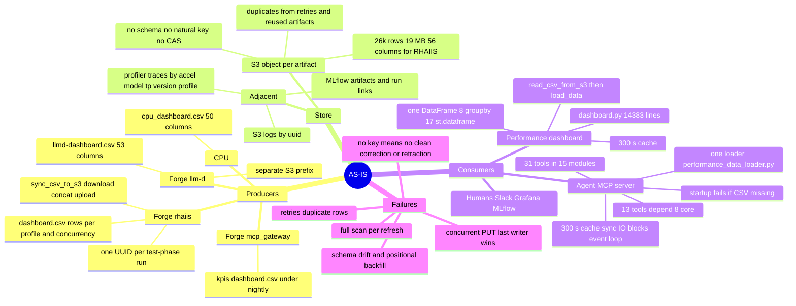
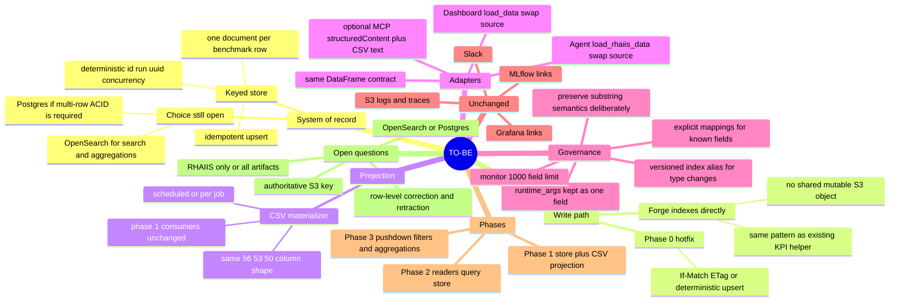

# CSV → OpenSearch: Grounded As-Is / To-Be

Research pass for the 2026-11-04 PSAP-Automation/Tooling Unification Sync.
Sources: meeting transcript/notes, `/Users/aansharm/forge`,
`/Users/aansharm/AI-Analysis-Agent`, `/Users/aansharm/performance-dashboard`,
and the primary OpenSearch/AWS/MCP documentation cited below.

## What the play actually is

This is **consolidation, not adoption**. Forge already has the OpenSearch
client, the `opensearch-py` extra, the `forge-kpis` index name, and a
deterministic-ID KPI writer/reader helper at
`projects/caliper/engine/kpi/import_export.py`. The helper is not wired into the
main pipeline (`export_kpis_to_index` has no caller; the CLI uses the import
path), so the pattern is in-tree but not yet a production system of record.

The real fault line is the **write path**, not query capability:

- `sync_csv_to_s3` does download → concat → upload on one S3 key.
- AWS resolves concurrent PUTs last-writer-wins; there is no atomic append.
- The live CSV already contains duplicate natural-key groups because nothing
  dedups.
- Both consumers already funnel through one loader each, so an adapter that
  returns the same DataFrame is far cheaper than the meeting assumed.
- OpenSearch can do the reads, but it introduces schema-governance and
  multi-document-ACID costs that must be designed, not assumed away.

At **26,024 rows / 19 MB / 56 columns**, scale is not the reason to migrate.
Keying, concurrency safety, and field-level query semantics are.

**The store choice is not settled.** The meeting leaned OpenSearch because an
instance is available and Alex knows it, but the evidence does not establish
OpenSearch as the better system of record for this workload. The data is small
and tabular, the queries are filters/substring/top-N/groupby, and corrections
need multi-row atomicity. **Postgres is the lower-risk default; OpenSearch is
justified as a search/analytics index if full-text/fuzzy search or much larger
scale becomes the core requirement.** The prototype should benchmark both on the
same 26,024-row corpus, not assume the winner.

## Grounded concern matrix

| Concern (speaker) | Verdict | Evidence |
|---|---|---|
| **Sai: two jobs finished together, only one reached the dashboard** | **Confirmed.** The write is an unguarded whole-object read-modify-write. | `projects/rhaiis/postprocess/s3_dashboard.py:43-67`: download, `pd.concat`, `upload_file` to one key. No ETag/If-Match, lock, dedupe, or retry. `test_phase.py:630-648` logs sync failure but never raises. AWS: concurrent PUTs are last-writer-wins, no atomic append. |
| **Aanya: 10k+ rows, Google Sheets editing, overwrite risk** | **Confirmed and worse.** | Local snapshot: 26,024 rows, 56 columns, 19 MB, 2,011 non-empty UUIDs, 325 run labels, 109 models, 287 versions. 689 UUIDs span more than one profile; max 5 profiles. |
| **Harshith: ~8 of 35 MCP tools parse CSV** | **Partially true; wrong numbers and mechanism.** | The MCP server registers **31 tools in 15 modules**, not 35. Exactly **one** module parses CSV (`performance_data_loader.py`). **13 of 31** tools depend on that loader; the 8 are the core performance tools. No tool parses CSV itself. |
| **Alex: a CSV/JSON adapter makes the backend swap lightweight** | **Partially supported.** It is a read seam, not a full migration. | Dashboard has one read boundary: `read_csv_from_s3` → `load_data()` → one DataFrame. Agent has one loader: `load_rhaiis_data()`. If the adapter returns the same DataFrame/columns, the 13 tools and dashboard pages can keep reading. But the adapter does **not** fix the write race, multi-row corrections/retractions, mapping/schema governance, startup validation, S3-first precedence, cache invalidation, event-loop blocking, substring semantics, or agent prompt wording. |
| **Harshith: NoSQL cannot filter/return specific columns; hard to scan** | **Mostly false for OpenSearch, with caveats.** | OpenSearch query DSL supports field filters, `_source` filtering, nested bucket + metric aggregations, and pagination. But mappings are mandatory for SQL/PPL, exact keyword vs analyzed text changes substring semantics, and deep `from+size` beyond 10,000 needs scroll/PIT. |
| **Kevin: keep metadata + key artifacts; minimal change** | **Valid and already decoupled.** | Dashboard logs use `logs/{uuid}.log`; profiler traces use `{prefix}/{accel}/{model}/tp{N}/{version}/{profile}/`; MLflow links use `mlflow_run_id`/`mlflow_experiment_id`; Grafana links use accelerator/version metadata. Keep S3 and MLflow untouched; migrate only the metadata/CSV plane. |
| **Kevin/Avi: RHAIIS vs llm-d vs all projects** | **Code says RHAIIS-only for the racy CSV.** | Only RHAIIS writes `staging/rhaiis-dashboard/consolidated_dashboard.csv` (56 cols). llm-d writes `llmd-dashboard.csv` (53 cols) to its own prefix; CPU has 50 cols; mcp_gateway writes `kpis/dashboard.csv` under `nightly/`. 45 columns overlap; 67-column union. Scope the MVP to RHAIIS. |
| **Harshith/Alex: 1–2 weeks or a major chunk** | **Partially true.** | The adapter seam reduces consumer changes, but the work includes mapping design, 26k-row backfill, startup/cache changes, dual-write/cutover, tests, and agent prompt wording. It is not a full rewrite; it is also not a one-day patch. |
| **Avi/Harshith/Kevin/Alex: relational DB vs OpenSearch** | **Open decision.** | OpenSearch: dynamic mapping, field queries, aggregations; no multi-document ACID, no SQL DELETE in 3.x, no in-place type changes, 1,000-field default cap. RDBMS: ACID, ILIKE substring semantics, rigid schema. The deciding question is whether multi-row correction/retraction is required. |
| **Aanya: schema evolution / multimodal breaks the CSV** | **Confirmed fragile.** | A branch pins the RHAIIS header to the consolidated order and records past positional backfills writing `uuid` into `ttft_p99` and `mlflow_run_id` into `turn_index`. `RHAIIS_FIELDNAMES` lacks `turn_index`/`env_vars`; pandas concat fills missing columns with NaN; there are no multimodal fields. |

## Data measured locally

- `consolidated_dashboard.csv`: **26,024 rows**, **56 columns**, **19 MB**.
- **2,011** non-empty UUIDs; **2,012** distinct including empty.
- **689** UUIDs have more than one profile; max **5** profiles.
- **109** models, **287** versions, **9** accelerators, **474** distinct
  `runtime_args` strings.
- Duplicate natural-key groups measured locally on
  `(uuid, run, measured concurrency)`: **464 groups**, **7,770 surplus rows**
  (29.8%); the prior research pass measured 454 groups / 7,452 surplus on a
  slightly different slice. Treat ~460 groups / ~7.7k rows as an upper bound:
  some differing-value groups may be legitimate re-runs. The largest group has
  40 rows.
- Growth by `guidellm_start_time_ms` month: 2025-11 through 2026-09 ranges from
  **107 to 1,971 rows/month** (15–263 UUIDs/month); **2026-10 is 12,700 rows /
  399 UUIDs**, almost certainly a bulk backfill; 2026-11 is 1,030 rows / 25
  UUIDs; 2,623 rows have no timestamp. This is a small, bursty dataset, not a
  high-volume event stream.
- Other artifacts: `llmd-dashboard.csv` 455 rows/53 cols;
  `cpu_dashboard.csv` 209 rows/50 cols.

## Relational vs OpenSearch: scale, query shape, frequency

This is the decision the meeting did **not** settle. The comparison has to be
made on the actual workload, not on “OpenSearch is available” or “Postgres is
familiar.”

### Scale and growth

- 26,024 rows, 56 columns, 19 MB today.
- Normal months: roughly **100–2,000 rows/month** and **15–263 UUIDs/month**
  (2025-11 through 2026-09).
- 2026-10: **12,700 rows / 399 UUIDs**, almost certainly a bulk backfill.
- 2026-11: 1,030 rows / 25 UUIDs; 2,623 rows have no timestamp.
- Rows per UUID: median **7**, p90 **50**, max **54** (profiles × concurrency).
- At this size and growth rate, Postgres handles the data trivially. OpenSearch
  is not needed for scale; it would be chosen for search/aggregation semantics,
  not volume.

### Query shape

- **Dashboard:** `read_csv_from_s3` → `load_data()` → one pandas DataFrame;
  filters in memory; 8 `groupby`; 17 `st.dataframe`; 300 s cache; no joins.
- **Agent:** 13 tools filter one DataFrame, do substring/token matching and
  top-N; no joins; 300 s cache; synchronous loader.
- **Frequency:** user-driven dashboard and ad-hoc agent calls, both cached for
  300 s. There is no evidence in the repos of a high-QPS query stream. Measure
  production request rate before choosing a search cluster.

### Decision matrix

| Dimension | Postgres | OpenSearch | Current verdict |
|---|---|---|---|
| **Scale** | Trivial at 26k rows / 19 MB; fine through millions | Handles it, but unnecessary | **Postgres** |
| **Query shape** | SQL filters, `ILIKE` substring, top-N, window/groupby; no joins needed | Query DSL, text/keyword/wildcard, nested bucket+metric aggregations | **Postgres for current queries; OpenSearch if full-text/fuzzy search becomes core** |
| **Query frequency** | Low, cached, interactive | Also fine, but a cluster for low QPS is overkill | **Postgres** |
| **Corrections/retractions** | Multi-row ACID transactions | Per-document atomicity; delete-by-query is non-atomic; no SQL DELETE in 3.x | **Postgres** |
| **Schema evolution** | Migrations + `JSONB` for new fields | Dynamic mapping, but types cannot change in place; 1,000-field default cap | **Tie; Postgres with JSONB is simpler to govern** |
| **Operations** | Already deployed for the agent (`openshift-manifests/02-postgresql.yaml`) | Lab instance exists, but no integration, mapping ownership, or reindex runbook | **Postgres** |
| **Full-text/fuzzy search** | `pg_trgm`/full-text can do some; less rich | Native strength | **OpenSearch** |
| **Large aggregations** | Fine at 26k rows; needs tuning later | Native strength at high cardinality/volume | **OpenSearch only if data grows** |
| **Team familiarity** | Aanya/Harshith lean SQL; Kevin wants a generic schema | Alex has OpenSearch experience | Mixed; not decisive |

**Recommendation:** make **Postgres the system of record first**. It matches the
current data volume, query shape, frequency, and correction needs, and it is
already deployed. Use **OpenSearch as a derived read/search index** only if
full-text/fuzzy search or much larger scale becomes the real requirement. If the
team still wants the OpenSearch MVP, frame it as a **bake-off against Postgres on
the same 26,024-row corpus**, not as the assumed production store.

## The adapter: what “CSV DataFrame” actually means

The adapter idea is credible **for reads**, because both consumers already
funnel through one pandas DataFrame:

- **Performance dashboard**
  - `read_csv_from_s3()` at `dashboard.py:345`, with `pd.read_csv` at `:360`.
  - `load_data()` at `:434`, with `pd.read_csv` at `:459`/`:462`.
  - `DATA_FILE = "consolidated_dashboard.csv"` and `df = load_data(...)` at
    `:11891`/`:11894`.
  - GitHub: https://github.com/openshift-psap/performance-dashboard/blob/main/dashboard.py#L345-L462
- **Agent MCP server**
  - `_read_csv_from_s3()` at `performance_data_loader.py:200`, `pd.read_csv` at
    `:232`.
  - `_clean_rhaiis_data()` at `:240`; `load_rhaiis_data()` at `:263`, with
    `pd.read_csv` at `:311`.
  - GitHub: https://github.com/openshift-psap/AI-Analysis-Agent/blob/master/psap-mcp-server/psap_mcp_server/src/tools/performance_data_loader.py#L200-L328
  - Tool registration: https://github.com/openshift-psap/AI-Analysis-Agent/blob/master/psap-mcp-server/psap_mcp_server/src/mcp.py#L144-L181
- **Forge producer**
  - `sync_csv_to_s3`: https://github.com/openshift-psap/forge/blob/main/projects/rhaiis/postprocess/s3_dashboard.py#L43-L67
  - Row generation: https://github.com/openshift-psap/forge/blob/main/projects/guidellm/postprocess/guidellm/dashboard.py#L621-L652
  - RHAIIS dashboard export: https://github.com/openshift-psap/forge/blob/main/projects/rhaiis/postprocess/plugin.py#L81-L128

The “CSV DataFrame” is the pandas frame produced by `pd.read_csv` with the
56-column RHAIIS header. The per-run artifact is `dashboard.csv` under
`<test-dir>/<NN>__postprocessing/`; the consolidated object is
`staging/rhaiis-dashboard/consolidated_dashboard.csv`. The adapter contract is
the **DataFrame schema and semantics**, not the CSV file itself.

**What the adapter preserves:** the read interface, the 13 dependent tools, and
the dashboard pages, provided it returns the same column names, types, and
substring behavior.

**What it does not solve:**

- the write race and lost updates;
- multi-row corrections/retractions and transactional guarantees;
- mapping/schema governance and reindexing;
- the agent’s startup validation (`main.py:93-96`) and S3-first precedence;
- cache invalidation (300 s TTL, no exposed refresh);
- the synchronous loader blocking the async event loop;
- agent prompt wording that hardcodes CSV semantics
  (`psap-agent/psap_agent/src/core/prompt.py:121-131`).

So Alex’s idea is a valid **phase-1 read seam**, not a complete migration
strategy. Calling it “fully supported” overstates it.

## Tools that depend on the CSV loader

All of these import `load_rhaiis_data()` from
`performance_data_loader.py`. None parses CSV directly. If the adapter returns
the same DataFrame, they are unchanged; if the backend is queried natively, each
filter/group/top-N must be translated and the substring semantics preserved.

| # | Tool | Module / function | Data it uses | Same DataFrame | Native store |
|---|---|---|---|---|---|
| 1 | `query_performance_metrics` | `query_performance_tool.py:16` | model/accelerator/version/TP, profile, metrics, top-N | None | SQL `ILIKE` or OpenSearch text/wildcard; preserve token matching |
| 2 | `compare_configurations` | `compare_performance_tool.py:115` | model/version/accelerator/TP, metrics | None | Query + comparison in app |
| 3 | `compare_versions_comprehensive` | `compare_performance_tool.py:458` | versions, model/accelerator/TP, `intended concurrency` | None | Query + group/compare |
| 4 | `calculate_cost_efficiency` | `cost_efficiency_tool.py:62` | `output_tok/sec`, TP, accelerator, prompt/output tokens | None | Query + aggregate |
| 5 | `calculate_energy_efficiency` | `energy_efficiency_tool.py:91` | `uuid`, metrics, Grafana power | None | Query + Grafana |
| 6 | `analyze_regression` | `regression_analysis_tool.py:16` | metric columns, version/model/accelerator/TP | None | Query + aggregate |
| 7 | `get_dataset_metadata` | `dataset_metadata_tool.py:16` | distinct model/version/TP/accelerator/timestamps | None | `SELECT DISTINCT` / terms aggregation |
| 8 | `discover_configurations` | `discover_configurations_tool.py:17` | distinct configurations, metrics | None | `SELECT DISTINCT` / terms aggregation |
| 9 | `query_grafana_metrics` | `grafana_metrics_tool.py:63` | `run`, `accelerator`, `TP`, `uuid`, timestamps | None | Query + Grafana |
| 10 | `compare_grafana_metrics` | `compare_grafana_metrics_tool.py:9` | `run`, `version`, `uuid`, timestamps | None | Query + Grafana |
| 11 | `generate_grafana_url` | `generate_grafana_url_tool.py:68` | `run`, `accelerator`, `model`, `version`, `TP`, `uuid`, timestamps | None | Query |
| 12 | `fetch_vllm_logs` | `vllm_log_tool.py:1151` | `uuid` lookup, S3 log | None | Query |
| 13 | `compare_vllm_logs` | `vllm_log_tool.py:1214` | `uuid` lookup, S3 logs | None | Query |

The 8 core performance tools are #1–#8; the 5 indirect consumers are
#9–#13. If the adapter is not exact, every one of these is exposed to
column-rename, type, or substring-semantics regressions.

## Aanya’s action item: what “shepherd” means

The notes assign three explicit items and one verbal commitment:

1. **Prototype OpenSearch Conversion** — build a prototype that converts CSV
   data into an OpenSearch backend and a converter that preserves the agent
   dashboard’s expected data structure.
2. **Document Implementation Plan** — create a Jira or shared-doc entry with the
   targeted execution plan.
3. **Shepherd NoSQL Evaluation** — manage the evaluation process and coordinate
   the suitability investigation.
4. **Lead the experiment** — agreed at 00:39:55, with Alex providing guidance.

Concretely, “shepherd” means **own the evaluation and recommendation, not the
production migration**:

- Define the success criteria and evaluation matrix: data model, query corpus,
  growth, query frequency/latency, consistency/corrections, ops.
- Load the 26,024-row CSV into OpenSearch with an explicit mapping and
  deterministic `_id`; build the CSV/DataFrame adapter; point a dev dashboard
  and the agent loader at it.
- Build the **Postgres baseline** on the same corpus and queries, because the
  store choice is not settled.
- Test filters, substring matching, top-N, groupby/aggregations,
  pagination/export, concurrent writes, and multi-row correction.
- Coordinate Nikhil (OpenSearch instance test) and Alex (guidance); document
  results in Jira/shared doc; recommend OpenSearch or Postgres.
- Do **not** cut over production, delete S3, or rewrite the 13 tools before the
  adapter proves out.

## AS-IS mindmap



Text outline:

```
AS-IS
├── Producers
│   ├── Forge/rhaiis: test-phase run → dashboard.csv → S3 CSV append
│   ├── Forge/llm-d: separate 53-col CSV/prefix
│   ├── Forge/mcp_gateway: kpis/dashboard.csv under nightly/
│   └── CPU: cpu_dashboard.csv (50 cols)
├── Store
│   ├── S3 object per artifact; 26k rows / 19 MB / 56 cols (RHAIIS)
│   ├── no schema, no natural key, no CAS, no dedupe
│   └── adjacent: S3 logs/{uuid}.log, profiler traces, MLflow
├── Consumers
│   ├── Performance dashboard: read_csv_from_s3 → load_data → pandas
│   ├── Agent: 31 tools / 15 modules → one loader → 13 dependent tools
│   └── Humans / Slack / Grafana / MLflow click-through
└── Failures
    ├── concurrent PUT: last writer wins
    ├── retries / reused ARTIFACT_DIR: duplicate rows
    ├── no key: can't correct/retract cleanly
    ├── schema drift: header order / positional backfill
    └── full scan per refresh
```

## TO-BE mindmap



Text outline:

```
TO-BE
├── System of record: keyed store (OpenSearch or Postgres decision)
│   └── document per row; deterministic _id; idempotent upsert
├── Write path
│   ├── Forge indexes directly (forge-kpis pattern)
│   └── Phase 0: If-Match/ETag or upsert hotfix
├── Projection: store → CSV materializer → same 56/53/50-col shape
├── Adapters
│   ├── Dashboard: load_data() source swap
│   ├── Agent: load_rhaiis_data() source swap
│   └── Same DataFrame contract; optional MCP structured + CSV text
├── Governance: explicit mappings, runtime_args as one field,
│   versioned alias, 1,000-field alarm, preserve substring semantics
├── Unchanged: S3 logs/traces, MLflow, Grafana, Slack
├── Phases
│   ├── 1: write store + materialize CSV (consumers unchanged)
│   ├── 2: readers query store behind same DataFrame
│   └── 3: push filters/aggs down
└── Open questions: store choice, ACID for corrections, S3 key, scope
```

## Recommended sequence (grounded)

1. **Phase 0 — stop the bleeding (days).** Add `If-Match`/ETag conditional write
   with bounded retry to `sync_csv_to_s3`, or route writes through the
   deterministic-ID upsert already used by the KPI helper. This removes lost
   updates; upsert also removes duplicate rows. This is independent of the store
   choice.
2. **Phase 1 — store bake-off + adapter (Aanya’s prototype).** Load the same
   26,024-row corpus into OpenSearch with an explicit mapping and into Postgres
   with a real schema. Build the CSV/DataFrame adapter once and point it at
   each. Run the same query corpus: filters, substring, top-N, groupby,
   pagination/export, concurrent writes, corrections. Measure latency, fidelity,
   ops effort, and failure modes.
3. **Phase 2 — choose the system of record.** Pick Postgres or OpenSearch based
   on the bake-off, not on availability. Keep the CSV materialized from the
   chosen store so the dashboard and agent remain unchanged.
4. **Phase 3 — swap the read path.** Point `load_data()` and
   `load_rhaiis_data()` at the store behind the same DataFrame contract;
   preserve column names and substring semantics.
5. **Phase 4 — push down filters/aggregations** for
   `query_performance_metrics`, `discover_configurations`, and the dashboard’s
   groupbys.

## Open questions that decide the store

1. **OpenSearch or Postgres?** No ADR/design doc/migration branch exists in any
   repo. The meeting chose an OpenSearch MVP, but the data volume, query shape,
   and correction needs point to Postgres as the lower-risk system of record.
   Decide with the bake-off, not by availability.
2. **Do consumers need row-level correction/retraction?** If yes, OpenSearch’s
   per-document atomicity plus upsert may not be enough; multi-row transactions
   force a relational backend.
3. **What is the real query rate and latency SLO?** The repos show 300 s caches,
   full-frame loads, and user-driven dashboard/agent calls. Measure production
   request rate and p95 latency before choosing a search cluster.
4. **Which S3 key is authoritative?** Forge writes
   `staging/rhaiis-dashboard/consolidated_dashboard.csv`; the agent’s settings
   default to `main/rhaiis-dashboard/consolidated_dashboard.csv`; the dashboard
   deployment YAML still carries placeholders. Resolve before dual-write.
5. **Scope:** RHAIIS consolidated CSV only, or all three artifacts (RHAIIS 56,
   llm-d 53, CPU 50) plus mcp_gateway nightly? The 45-column overlap makes a
   unified schema feasible, but doing all at once multiplies the consumer
   surface with no added safety.
6. **Growth and multimodality:** current normal months are 100–2,000 rows; the
   2026-10 spike is 12,700 rows (likely backfill). Project multimodal rows and
   decide whether the store needs search at scale or just a larger table.

## Corrections to the meeting framing

- The MCP tool count is **31**, not 35; CSV-dependent tools are **13 of 31**,
  not 8 of 35. The 8 are the core performance tools.
- The failure is **whole-object lost update**, not a pandas `to_csv(mode="a")`
  header race. Forge rewrites the S3 object.
- Scale is not the driver: 26k rows / 19 MB is trivial for either store; normal
  growth is 100–2,000 rows/month.
- **The store choice is not settled.** OpenSearch was chosen for an MVP, but the
  data volume, query shape, correction needs, and existing Postgres deployment
  point to Postgres as the lower-risk system of record. Benchmark both.
- **The adapter is a read seam, not a full migration.** It preserves the
  dashboard/agent DataFrame contract; it does not fix the write race,
  multi-row ACID, mapping governance, startup/cache behavior, or substring
  semantics.
- OpenSearch is not schema-free at query time: mappings are mandatory for
  SQL/PPL, field types cannot change in place, and the default field cap is
  1,000.
- OpenSearch has no multi-document ACID; SQL `DELETE` is unsupported in 3.x,
  and delete-by-query is non-atomic. Per-document upsert is the safe primitive.
- CSV export from OpenSearch Dashboards is not missing; the “only saved
  searches” claim was refuted.

## Sources

Primary:

- AWS S3 multi-writer controls: https://aws.amazon.com/blogs/storage/building-multi-writer-applications-on-amazon-s3-using-native-controls/
- AWS S3 consistency model: https://docs.aws.amazon.com/AmazonS3/latest/userguide/Welcome.html
- OpenSearch mappings: https://docs.opensearch.org/latest/mappings/
- OpenSearch mapping explosion / field limit: https://docs.opensearch.org/latest/mappings/mapping-explosion/
- OpenSearch SQL/PPL limitations: https://docs.opensearch.org/latest/sql-and-ppl/limitation/
- OpenSearch aggregations: https://docs.opensearch.org/latest/aggregations/
- OpenSearch pagination: https://docs.opensearch.org/latest/search-plugins/searching-data/paginate/
- OpenSearch delete-by-query: https://docs.opensearch.org/latest/api-reference/document-apis/delete-by-query/
- MCP tools specification: https://modelcontextprotocol.io/specification/2026-07-28/server/tools

Local:

- `projects/rhaiis/postprocess/s3_dashboard.py:43-67`
- `projects/rhaiis/orchestration/test_phase.py:138-140, 630-648`
- `projects/rhaiis/postprocess/csv_dashboard.py:6-61`
- `projects/caliper/engine/kpi/import_export.py:13-37`
- `projects/caliper/engine/kpi/opensearch_client.py:8-34`
- `AI-Analysis-Agent/psap-mcp-server/psap_mcp_server/src/mcp.py`
- `AI-Analysis-Agent/psap-mcp-server/psap_mcp_server/src/tools/performance_data_loader.py`
- `performance-dashboard/dashboard.py:345-488`
- `performance-dashboard/dashboard_taxonomy.py:144-193`
- `performance-dashboard/consolidated_dashboard.csv`

## Caveats

- Local CSV snapshot is dated 2026-11-03; no live OpenSearch cluster, production
  dashboard, or S3 access was used.
- The 7,452 surplus-row figure is an upper bound; only 11 byte-identical groups
  are unambiguous.
- OpenSearch behavior is version-sensitive: SQL `DELETE` existed in 2.x behind
  `plugins.sql.delete.enabled` and was removed in 3.x.
- Forge’s OpenSearch KPI export helper exists but has no caller in the main
  pipeline; do not describe it as an active production write without checking
  the deployment.
