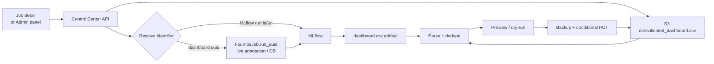

# Dashboard CSV Amendment Plan — Level 2

Detailed reference for the work described in
[Level 1](dashboard-csv-amendment-plan.md). It assumes the vision, wireframes, and
scope in that document.

**Base:** PR #104 (`Align Fournos dashboard features in Control Center`, branch
`codex/fournos-dashboard-parity`, open against `development`). PR #104 supplies
the Fournos Dashboard navigation, the admin job action bar, the CPT Jobs panel,
the history backfill, the MLflow httpx client, and the DB migration pattern. It
does **not** supply any S3/CSV writer.

**Gap:** `POST /fournos/cpt-runs/{run_id}/version` updates
`FournosJob.cpt_run_metadata.version_label` and recomputes `cpt_group_id`. It is
keyed by the CPT submission UUID and only changes Control Center's grouping. The
CSV operation is keyed by the CSV `uuid` column and changes the row the staging
dashboard reads. Do not reuse the CPT endpoint.

The CSV `uuid` is a third identifier: Forge generates it as
`tests.rhaiis.run_uuid` (a random UUID unless configured). It is not the
FournosJob name, the Kubernetes UID, or the MLflow run ID. That is why the mapping
table below matters.

## 1. Identifiers

The issue's "UUID" covers more than one identifier. The contract must be explicit
so the UI and API never edit the wrong record.

| Identifier | Where it lives | Stable? | Use |
|---|---|---|---|
| **Dashboard UUID** | CSV `uuid` column; live FournosJob annotation `rhaiis.run-uuid`; archived `fjob_status.engineStatus.forge.relevantDeployments[].runUUID` | Yes, per test-phase run | Primary key for rename, import, delete. One UUID covers all rows for that run. |
| **MLflow run ID** | `FournosJob.mlflow_url`; live status `exportArtifacts...mlflow.run_url` | Yes | Fetch the run's `dashboard.csv`. Accept a run URL or raw ID. |
| **CSV `mlflow_run_id` column** | Dashboard row itself | Not reliable | Secondary hint only. The CSV is generated before the export step, so it can be blank on the original push. |
| **CPT `run_id` / `group_id`** | Control Center CPT tracking tables | Yes | CPT grouping only. Never the CSV key. |
| **FournosJob name** | Kubernetes / archive DB | Yes | UI navigation and audit context, not the row key. |

### Mapping rule

1. Job detail push: resolve the dashboard UUID from the live annotation first,
   then from archived `fjob_status`.
2. Resolve the MLflow run from `mlflow_url`, then from the live export status.
   Parse the run ID from the URL; do not assume the latest run.
3. Admin import by dashboard UUID: look up the indexed `fournos_jobs.run_uuid`
   column. If empty, derive it from `fjob_status`. Only if both are missing, fall
   back to an MLflow search on the optional `rhaiis.run_uuid` tag.
4. If none resolve, return 404 naming the missing link; never guess a run.

Add `fournos_jobs.run_uuid` (`VARCHAR(64)`, indexed) and populate it in the
watcher and history backfill. Without it, an import by UUID must scan JSON status
blobs on every request. With it, the lookup is one indexed query and the job
detail state check is cheap.

## 2. API surface

All endpoints live under `/api/v1/fournos`, matching PR #104's router. Mutations
require `require_admin`; the state and summary reads used by the admin UI do too.
Every mutation supports `dry_run` and returns the same result shape.

| Method | Path | Purpose |
|---|---|---|
| `GET` | `/jobs/{job_name}/dashboard-state` | Eligibility, UUID/run mapping, already-pushed state. |
| `POST` | `/jobs/{job_name}/push-dashboard` | Issue #94 button: import the job's MLflow rows. |
| `GET` | `/dashboard-csv/summary` | Bucket/key, row count, size, ETag, last modified. |
| `GET` | `/dashboard-csv/rows?uuid=...` | Preview matching rows before a mutation. |
| `POST` | `/dashboard-csv/version` | Rename `version` for every row matching the supplied UUIDs. |
| `POST` | `/dashboard-csv/import` | Append or replace rows from an MLflow run. |
| `POST` | `/dashboard-csv/delete` | Delete every row matching the supplied UUIDs. |
| `GET` | `/dashboard-csv/audit?limit=...` | Optional phase-3 read of the mutation log. |

### Job state

```json
GET /api/v1/fournos/jobs/forge-rhaiis-xyz/dashboard-state

{
  "configured": true,
  "eligible": true,
  "run_uuid": "4f1c9a2e-...",
  "mlflow_run_id": "a1b2c3d4e5f6...",
  "mlflow_url": "https://mlflow.../#/experiments/116/runs/...",
  "rows_in_csv": 3,
  "already_pushed": true,
  "csv": {
    "bucket": "psap-dashboard-data",
    "key": "staging/rhaiis-dashboard/consolidated_dashboard.csv",
    "etag": "\"9f2c...\"",
    "last_modified": "2026-11-03T10:22:31Z"
  }
}
```

### Mutation result

```json
{
  "status": "ok",
  "dry_run": false,
  "action": "rename_version",
  "run_uuids": ["4f1c9a2e-..."],
  "rows_before": 1284,
  "rows_after": 1284,
  "rows_affected": 3,
  "rows_skipped": 0,
  "backup_key": "staging/rhaiis-dashboard/backups/consolidated_dashboard-20261103T102233Z.csv",
  "etag_before": "\"9f2c...\"",
  "etag_after": "\"1a7d...\"",
  "sample": [
    {
      "uuid": "4f1c9a2e-...",
      "model": "openai/gpt-oss-120b",
      "version": "vLLM-0.24.0-benchmark",
      "intended concurrency": "32"
    }
  ]
}
```

### Request bodies

```json
POST /dashboard-csv/version
{"uuids": ["4f1c9a2e-..."], "version": "vLLM-0.24.0-benchmark", "dry_run": false}

POST /dashboard-csv/delete
{"uuids": ["4f1c9a2e-..."], "dry_run": false}

POST /dashboard-csv/import
{"run_id": "a1b2c3d4e5f6...", "mode": "append", "dry_run": false}
{"run_url": "https://mlflow.../#/experiments/116/runs/...", "mode": "append"}
{"uuid": "4f1c9a2e-...", "mode": "replace", "dry_run": true}

POST /jobs/forge-rhaiis-xyz/push-dashboard
{"mode": "append", "dry_run": false}
```

### Errors

| Status | When |
|---|---|
| `400` | Invalid UUID format, empty/oversized version, empty list, or too many UUIDs. |
| `403` | Authenticated but not an admin. |
| `404` | UUID not in CSV, MLflow run not found, or run has no `dashboard.csv`. |
| `409` | Import found existing rows and `mode=append` would duplicate them. |
| `412` | ETag conflict survived the retry budget. |
| `503` | Dashboard S3 or MLflow is not configured. |

## 3. Backend design

### New files

| File | Responsibility |
|---|---|
| `backend/app/services/dashboard_csv.py` | S3 store: read, parse, mutate, backup, conditional write, ETag cache. Pure CSV logic is separated from boto3 for testing. |
| `backend/app/services/mlflow_artifacts.py` | Bounded artifact traversal and download; reuses `_client_options` and `parse_run_reference`. |
| `backend/app/services/dashboard_job_link.py` | Resolve a live or archived job to `{run_uuid, mlflow_run_id, mlflow_url}`. |
| `backend/app/api/dashboard_csv.py` | FastAPI router: validation, auth, error mapping, audit. |
| `backend/app/models/dashboard_csv_audit.py` | One row per mutation: actor, action, UUIDs, version, counts, ETags, backup key, timestamp. |

### CSV write algorithm

1. `head_object` the configured key. Reject objects over
   `DASHBOARD_CSV_MAX_BYTES`; return ETag, size, and last-modified time.
2. `get_object` and parse with `csv.DictReader` using `utf-8-sig`. Require `uuid`
   and `version`; keep the original header order.
3. Apply the mutation in memory and compute rows before/after, rows affected,
   rows skipped, and a five-row sample.
4. If `dry_run`, return the preview without writing.
5. `copy_object` the current object to the backup prefix with a UTC timestamp.
6. `put_object` the serialized CSV with `ContentType="text/csv"` and
   `IfMatch=etag`. On `PreconditionFailed`, re-read and retry up to three times.
7. Write the audit row and invalidate the ETag cache.

Serialize with `csv.DictWriter(..., lineterminator="\n",
quoting=csv.QUOTE_MINIMAL)` and write the same header. Unchanged rows are
re-emitted from the parsed dictionaries, so numeric strings keep their original
text.

### Row identity

A run can contribute several rows: one per model and profile. The dedupe key must
include the profile identity, not just the UUID:

```
uuid, model, prompt toks, output toks, intended concurrency,
request_type, turns, prefix_tokens, prefix_count
```

Rows with an empty `uuid` are historical or malformed; never match them by UUID
and never delete them implicitly. The importer skips rows whose key already
exists in `append` mode. In `replace` mode it removes all rows for the resolved
UUID first, then appends the imported set.

### MLflow import

1. Resolve the run: explicit `run_id`/`run_url`, or dashboard UUID through
   `dashboard_job_link`.
2. Traverse artifacts breadth-first from the run root, bounded by
   `MAX_ARTIFACT_ENTRIES=200` and `MAX_ARTIFACT_LIST_REQUESTS=50`, matching the
   existing MLflow services.
3. Select files whose basename is `dashboard.csv` (case-insensitive) and whose
   size is under the configured per-file limit. Download with `/get-artifact`.
4. Parse and merge every selected file. Deduplicate by the row key. If no artifact
   is found, return 404 with the run ID and a hint to push the run through Forge.
5. Apply `append` or `replace`, then use the same conditional write path.

### Configuration

```env
# Dashboard CSV (unset bucket = feature disabled)
DASHBOARD_S3_BUCKET=psap-dashboard-data
DASHBOARD_S3_KEY=staging/rhaiis-dashboard/consolidated_dashboard.csv
DASHBOARD_S3_REGION=us-east-1
DASHBOARD_CSV_BACKUP_PREFIX=staging/rhaiis-dashboard/backups/
DASHBOARD_CSV_PROJECTS=rhaiis
DASHBOARD_CSV_MAX_BYTES=52428800
DASHBOARD_CSV_MAX_UUIDS=1000
DASHBOARD_CSV_CACHE_SECONDS=30
DASHBOARD_CSV_DRY_RUN=false

# AWS credentials are supplied by the runtime secret, never committed.
# AWS_ACCESS_KEY_ID / AWS_SECRET_ACCESS_KEY / AWS_SESSION_TOKEN
```

`MLFLOW_TRACKING_URI`, `MLFLOW_WORKSPACE`, `MLFLOW_TRACKING_USERNAME`,
`MLFLOW_TRACKING_PASSWORD`, and `MLFLOW_TRACKING_INSECURE_TLS` already exist in
`config.py`; reuse them. If either S3 or MLflow is unconfigured, the API returns
503 and the UI hides the feature.

### Schema and migration

```python
# app/models/fournos_job.py
run_uuid = Column(String(64), default="", index=True)

# app/core/database.py
("fournos_jobs", "run_uuid", "VARCHAR(64)"),
# _INDEXES: ("ix_fournos_jobs_run_uuid", "fournos_jobs", "run_uuid"),
```

Populate `run_uuid` in `fournos_watcher.py` from the annotation first, then from
`relevantDeployments[].runUUID`. Extend the history backfill to fill it where the
stored `fjob_status` has the value. A one-off backfill for already-archived jobs
can reuse the same function; it is safe to run repeatedly.

## 4. Frontend design

### Job detail: the issue #94 button

Add the action to the existing admin action bar in `TestingJobDetail.tsx`, next to
Cancel, Run Again, and Edit & Submit. Visibility is deliberately narrow:

- `isAdmin()` is true.
- `displayPhase === "Succeeded"`.
- `forge_info.project === "rhaiis"` (or a configured project allowlist).
- `dashboard-state.configured` is true.

If `already_pushed` is true, show a disabled **Already on dashboard** state and a
link to the admin panel for corrections. Otherwise the button opens a
confirmation panel with the resolved UUID, MLflow run, target S3 path, and a
dry-run row preview. After a successful write, show the backup key and a link to
the staging dashboard.

### Admin panel: all three operations

Add `frontend/src/components/DashboardCsvPanel.tsx`, modeled on
`CptJobsPanel.tsx`. It renders when `activeTab === "dashboard-csv"` and the user is
an admin. Three sections:

- **Rename version:** UUIDs on separate lines, new version label. Preview counts
  matching rows and shows a sample. Apply writes `version` only.
- **Import from MLflow:** run ID, run URL, or dashboard UUID. Choose skip existing
  or replace. Preview lists rows that will be added, skipped, or replaced.
- **Delete rows:** UUIDs on separate lines. Preview first; apply requires typing
  `DELETE`. The result reports the backup key and row count removed.

Every action shows rows before/after, rows affected, ETag change, and the S3
backup path. No silent success toast: the counts are the confirmation.

### Wiring

- `Layout.tsx`: add `{ id: "dashboard-csv", name: "Dashboard CSV", href:
  "/testing?tab=dashboard-csv" }` to `fournDashboardSubnav`, filtered to admins.
- `Testing.tsx`: render `{activeTab === "dashboard-csv" && isAdmin() &&
  <DashboardCsvPanel />}`; keep the tab unreachable for non-admins.
- `hooks/useFournos.ts`: `useDashboardJobState`, `usePushJobToDashboard`,
  `useDashboardCsvSummary`, `useDashboardCsvRows`, `useDashboardCsvMutation`.
- `services/api.ts`: add methods to `fournosApi`; encode job names and path
  segments.
- `types/index.ts`: `DashboardJobState`, `DashboardCsvSummary`,
  `DashboardCsvRow`, `DashboardCsvMutationResult`.

Use the existing React Query invalidation style. A successful mutation invalidates
the job detail query and dashboard summary; the preview query is keyed by the
request body so a dry run and a live run do not share a cache entry.

## 5. Forge changes

### 1. Tag the MLflow run with the dashboard UUID (optional)

The normal mapping does not need this tag: Control Center reads the UUID from the
live `rhaiis.run-uuid` annotation or archived `relevantDeployments`, and gets the
MLflow run from `mlflow_url`. The tag only covers old, backfilled, or incomplete
job records where those fields are missing, and lets Control Center search MLflow
directly instead of joining through the job DB.

If that fallback is worth having, pass `run_uuid` into `_set_mlflow_metadata` in
`projects/rhaiis/orchestration/test_phase.py` and add
`"rhaiis.run_uuid": run_uuid` to the MLflow tags. The existing tag merge in
`_inject_fournos_job_tags` keeps these tags intact. Skip it if the job archive is
complete enough for the lookup.

### 2. Make the append idempotent and conditional (required)

In `projects/rhaiis/postprocess/s3_dashboard.py`, change `sync_csv_to_s3` from
download -> concat -> unconditional upload to:

1. `head_object` for the current ETag.
2. Download and parse both CSVs. Validate that the new header matches the
   consolidated header.
3. Deduplicate on the same row key used by Control Center. Forge keeps the new
   row and logs a warning when a key already exists.
4. `put_object(..., IfMatch=etag)`; on `PreconditionFailed`, re-read and retry up
   to three times.

This is the only shared-state safety requirement. Without it, a Forge job that
finishes while an admin edits the CSV can overwrite the admin's change, and vice
versa. The bucket is AWS S3, which supports conditional PutObject with `If-Match`;
pin a botocore version that exposes it.

Do not add a Forge HTTP service or a new FournosJob pipeline for these operations.
The only reason to run Forge would be to regenerate rows from raw artifacts; the
per-run `dashboard.csv` is already exported to MLflow, so Control Center can
consume it directly.

## 6. Concurrency, safety, rollback



- **Two writers, one object.** Control Center and Forge both use ETag conditional
  writes and a three-attempt retry. A stale writer gets 412, re-reads, and
  reapplies its change.
- **Backups are mandatory.** Every live mutation copies the current object to the
  backup prefix before writing. The audit row records the backup key, so rollback
  is a copy, not a reconstruction.
- **Preview before destructive actions.** Delete always requires a preview and
  typed confirmation. Rename and import default to dry-run in the UI; apply is a
  second step.
- **Bounded inputs.** Limit UUID count, version length, CSV size, artifact walk
  entries, and per-artifact size. Reject control characters and newlines in UUIDs
  and versions.
- **No silent partial success.** If the write fails after the backup, the response
  says the CSV is unchanged and names the backup.
- **Feature flag by configuration.** Unset `DASHBOARD_S3_BUCKET` disables the
  endpoints with 503 and hides the UI, making the change safe to merge before the
  deployment secret exists.

## 7. Delivery sequence

Stack the Control Center work on `codex/fournos-dashboard-parity` (PR #104)
because that branch rewrites `Testing.tsx`, `TestingJobDetail.tsx`, and
`Layout.tsx`. Open the CC PR against PR #104's branch, then retarget it to
`development` once #104 merges. Do not rebase or force-push the branch; merge
`development` into it if #104 changes.

| Phase | Side | Scope | Files |
|---|---|---|---|
| 0 | Forge | Required: dedupe + conditional append; tests. Optional: tag MLflow runs with `rhaiis.run_uuid`. | `test_phase.py`, `s3_dashboard.py`, tests |
| 1 | CC | Config, `run_uuid` column/index, S3 store, CSV ops, MLflow artifact service, job-link resolver, unit tests with an in-memory store. | `config.py`, `fournos_job.py`, `database.py`, `dashboard_csv.py`, `mlflow_artifacts.py`, `dashboard_job_link.py`, tests |
| 2 | CC | Router, schemas, admin auth, dry-run, error mapping, audit model/endpoint, integration tests. | `api/dashboard_csv.py`, `schemas/fournos.py`, `dashboard_csv_audit.py`, tests |
| 3 | CC | Job-detail push action, admin `Dashboard CSV` tab, hooks/types/API methods, nav entry, component tests. | `TestingJobDetail.tsx`, `DashboardCsvPanel.tsx`, `Testing.tsx`, `Layout.tsx`, `useFournos.ts`, `api.ts`, `types/index.ts` |
| 4 | Both | Deployment secret, `.env.example`, deploy README, dry-run against a CSV copy, rollback runbook. | `deploy/README.md`, `.env.example`, runbook |

Suggested PR split: one small Forge PR, then two stacked Control Center PRs
(backend phases 1-2, UI phase 3). The backend can merge before the UI; the UI can
merge before the deployment secret because the endpoints stay dark until
`DASHBOARD_S3_BUCKET` is set.

## 8. Test plan

### Backend

- **Fake S3 store:** in-memory `head_object`, `get_object`, `put_object` with ETag
  enforcement, `copy_object`. Tests never touch real AWS.
- **Fake MLflow:** `httpx.MockTransport` returning an artifact tree with one or
  more `dashboard.csv` files, a missing artifact, and an oversized artifact.
- **Rename:** only matching UUID rows change; other rows are byte-identical;
  dry-run writes nothing; empty and oversized versions are rejected.
- **Delete:** matching rows disappear; empty-UUID rows are untouched; dry-run
  writes nothing; the backup is created before the write.
- **Import:** append skips existing keys; replace removes the resolved UUID's rows
  first; multiple artifacts merge and dedupe; missing artifact returns 404.
- **Concurrency:** a stale ETag causes one retry and preserves both writers'
  changes; exhausting retries returns 412 and leaves the object unchanged.
- **Mapping:** live annotation, archived `relevantDeployments[].runUUID`,
  `mlflow_url` parsing, and MLflow tag-search fallback.
- **Auth:** anonymous 401, signed-in non-admin 403, admin 200 for every mutation.
- **Migration:** start from a pre-column SQLite/Postgres schema and verify
  `run_uuid` and its index are added idempotently.

### Frontend

- Job detail button is hidden for non-admins, non-RHAIIS projects, and
  non-Succeeded jobs; disabled when `already_pushed`.
- Preview renders the row count and sample; Apply stays disabled until a preview
  exists; delete requires the typed confirmation.
- Mutation success updates the displayed counts and shows the backup key; failure
  leaves the preview visible with the server message.

### Manual

1. Point `DASHBOARD_S3_KEY` at a copy such as
   `staging/rhaiis-dashboard/test/consolidated_dashboard.csv` and run every
   operation with `dry_run=true`.
2. Run a real rename and confirm the staging dashboard reflects it after its
   import cycle.
3. Start a Forge job that appends to the copy while applying a Control Center
   edit; verify neither update is lost.
4. Restore a backup key and confirm the dashboard returns to the previous state.

Existing commands: `cd backend && pytest`; `cd frontend && npm run test`,
`npm run lint`, `npm run build`. PR #104 reports 155 backend and 35 frontend
tests; this feature should add focused tests to those totals.

## 9. Open decisions

| Decision | Recommendation | Why |
|---|---|---|
| Where do S3 write credentials live? | Control Center runtime secret | Interactive operations need direct writes. If policy forbids it, fall back to a Forge batch job. |
| Do we need the optional MLflow tag? | Skip initially; add only if old or incomplete job records are common | The job annotation/status plus `mlflow_url` cover the normal flow. |
| What does "UUID" mean in the UI? | Dashboard UUID by default; MLflow run ID/URL also accepted for import | The CSV key is the dashboard UUID. Requiring only the MLflow run ID makes rename and delete awkward. |
| Import when rows already exist | Skip by default; replace is explicit | A re-push should not duplicate rows. Replace is available for corrected results. |
| Rename scope | All rows for each UUID | Matches the issue wording and keeps a run's version consistent. Per-profile editing can come later. |
| Feature placement | Admin-only `Dashboard CSV` tab plus the job-detail button | The tab handles corrections across runs; the button handles the original #94 case in context. |
| Audit retention | Keep rows indefinitely; back up the CSV on every mutation | Storage cost is small; the backup key is the practical rollback path. |

## 10. File map

| Repo | File | Change |
|---|---|---|
| Forge | `projects/rhaiis/orchestration/test_phase.py` | Optional: pass `run_uuid` to `_set_mlflow_metadata`; add tag. |
| Forge | `projects/rhaiis/postprocess/s3_dashboard.py` | Modify: dedupe, ETag conditional write, retry, backup. |
| CC | `backend/app/services/dashboard_csv.py` | New: S3 store, CSV operations, ETag cache. |
| CC | `backend/app/services/mlflow_artifacts.py` | New: bounded artifact traversal/download. |
| CC | `backend/app/services/dashboard_job_link.py` | New: job-to-UUID/run resolution. |
| CC | `backend/app/api/dashboard_csv.py` | New: router and validation. |
| CC | `backend/app/models/dashboard_csv_audit.py` | New: audit table. |
| CC | `backend/app/models/fournos_job.py`, `backend/app/core/database.py` | Modify: `run_uuid` column, migration, index. |
| CC | `backend/app/services/fournos_watcher.py`, `fournos_history_backfill.py` | Modify: populate `run_uuid`. |
| CC | `backend/app/core/config.py`, `.env.example` | Modify: dashboard S3/CSV settings. |
| CC | `frontend/src/components/DashboardCsvPanel.tsx` | New: admin panel. |
| CC | `frontend/src/pages/TestingJobDetail.tsx` | Modify: push action and confirmation panel. |
| CC | `frontend/src/pages/Testing.tsx`, `components/Layout.tsx` | Modify: admin tab and subnav entry. |
| CC | `frontend/src/hooks/useFournos.ts`, `services/api.ts`, `types/index.ts` | Modify: hooks, methods, types. |
| CC | `backend/tests/test_dashboard_csv*.py` | New: unit, API, auth, conflict tests. |

## 11. Things this plan deliberately does not do

- Reuse `POST /cpt-runs/{run_id}/version` for CSV edits.
- Key rows on the CSV `mlflow_run_id` column.
- Call S3 from the browser or expose AWS credentials to the frontend.
- Append blindly on import or on Forge re-sync.
- Delete rows in one click without a preview and typed confirmation.
- Add a new Forge pipeline or service for a row rename.
