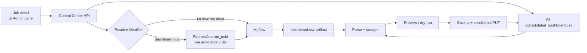

# Dashboard CSV Amendment Plan — Level 2

Detailed reference for the work described in
[Level 1](dashboard-csv-amendment-plan.md). It assumes the vision, wireframes, and
scope in that document.

**Base:** PR #104 (`Align Fournos dashboard features in Control Center`, branch
`codex/fournos-dashboard-parity`, open against `development`). PR #104 supplies
the Fournos Dashboard navigation, the admin job action bar, the CPT Jobs panel,
the history backfill, the MLflow httpx client, and the DB migration pattern. It
does **not** supply any S3/CSV writer.

**Gap:** `POST /fournos/cpt-runs/{run_id}/version` updates
`FournosJob.cpt_run_metadata.version_label` and recomputes `cpt_group_id`. It is
keyed by the CPT submission UUID and only changes Control Center's grouping. The
CSV operation is keyed by the CSV `uuid` column and changes the row the staging
dashboard reads. Do not reuse the CPT endpoint.

## 1. One run, several identifiers

The same run has a different identifier in each system. The dashboard's `uuid`
column is the only one the CSV cares about; it is not the FournosJob name, the
Kubernetes UID, or the MLflow run ID.

### Example

| System | Identifier | Example | Unique? | Notes |
|---|---|---|---|---|
| Fournos | Job name | `forge-rhaiis-gpt-oss-120b-7f3c` | Yes | What the UI shows and links to. |
| Fournos | Kubernetes UID | `b6e6...` | Yes | Not used by the dashboard; Control Center stores its own DB id. |
| Fournos | Annotation `rhaiis.run-uuid` | `4f1c9a2e-...` | Yes | Forge writes it at the start of the test phase. |
| Fournos | `relevantDeployments[].runUUID` | `4f1c9a2e-...` | Yes | Same value as the annotation, in the job status. |
| Forge | `tests.rhaiis.run_uuid` | `4f1c9a2e-...` | Yes | Random `uuid4()` unless configured; becomes the CSV `uuid`. |
| Dashboard | CSV `uuid` | `4f1c9a2e-...` | Yes | Groups all rows from one test-phase run. |
| Dashboard | CSV `mlflow_run_id` column | `a1b2...` or blank | Not reliable | Generated before export; can be empty on the original push. |
| Dashboard | CSV `run` column | `H200-zeus-openai/gpt-oss-120b-2` | No | Display name; one run has several rows. |
| MLflow | Run ID | `a1b2c3d4e5f60718293a4b5c6d7e8f90` | Yes | Appears in `/runs/<id>` and the API. |
| MLflow | Run name | `forge-rhaiis-gpt-oss-120b-7f3c` | No | Defaults to `FJOB_NAME`; reruns can reuse it. |
| MLflow | Experiment ID | `116` | No | Groups runs; not unique per run. |
| MLflow | `fjob.name` tag | `forge-rhaiis-gpt-oss-120b-7f3c` | No | Links the run back to the FournosJob. |
| Control Center | DB `id` | `9d2e...` | Yes | Internal row id; not the Fournos/K8s UID. |
| Control Center | `name` | `forge-rhaiis-gpt-oss-120b-7f3c` | Yes | Same as the FournosJob name. |
| Control Center | `cpt_run_id` / `cpt_group_id` | `...` | Yes | CPT grouping only; never the CSV key. |

### How they connect

- FournosJob **name** -> MLflow run **name** and **`fjob.name`** tag. Both are labels, not unique keys across reruns.
- FournosJob **`rhaiis.run-uuid` annotation** -> Forge **`tests.rhaiis.run_uuid`** -> CSV **`uuid`** -> **`deployment_uuid`** / **`relevantDeployments[].runUUID`**.
- FournosJob **`mlflow_url`** (or live `exportArtifacts...mlflow.run_url`) -> MLflow **run ID**. Parse the ID from the URL.
- CSV **`mlflow_run_id`** column is supposed to mirror the MLflow run ID, but the CSV is generated before export, so it can be blank on the original push. Do not use it as the join key.
- Control Center **`cpt_run_id` / `cpt_group_id`** are local to CPT grouping; they are not the FournosJob name or the CSV `uuid`.

### Mapping rule

1. Job detail push: read `rhaiis.run-uuid` from the live FournosJob annotation; if absent, read `relevantDeployments[].runUUID` from the archived `fjob_status`.
2. Resolve the MLflow run from `mlflow_url`, then from the live export status. Parse the run ID from the URL.
3. Admin import by dashboard UUID: look up the new indexed `fournos_jobs.run_uuid` column; if empty, derive it from `fjob_status`. Only if both are missing, fall back to an MLflow search on the optional `rhaiis.run_uuid` tag.
4. If none resolve, return 404 naming the missing link; never guess a run.

Could Forge just write the FournosJob name into the CSV `uuid`? That would change a
value already used for the deployment UUID, S3 log keys, and agent analysis
artifacts; existing rows would not match. The annotation/status bridge avoids that.

Add `fournos_jobs.run_uuid` (`VARCHAR(64)`, indexed) and populate it in the
watcher and history backfill. Without it, an import by UUID must scan JSON status
blobs on every request. With it, the lookup is one indexed query and the job
detail state check is cheap.

## 2. API surface

All endpoints live under `/api/v1/fournos`, matching PR #104's router. Mutations
require `require_admin`; the state and summary reads used by the admin UI do too.
Every mutation supports `dry_run` and returns the same result shape.

| Method | Path | Purpose |
|---|---|---|
| `GET` | `/jobs/{job_name}/dashboard-state` | Eligibility, UUID/run mapping, already-pushed state. |
| `POST` | `/jobs/{job_name}/push-dashboard` | Issue #94 button: import the job's MLflow rows. |
| `GET` | `/dashboard-csv/summary` | Bucket/key, row count, size, ETag, last modified. |
| `GET` | `/dashboard-csv/rows?uuid=...` | Preview matching rows before a mutation. |
| `POST` | `/dashboard-csv/version` | Rename `version` for every row matching the supplied UUIDs. |
| `POST` | `/dashboard-csv/import` | Append or replace rows from an MLflow run. |
| `POST` | `/dashboard-csv/delete` | Delete every row matching the supplied UUIDs. |
| `GET` | `/dashboard-csv/audit?limit=...` | Optional phase-3 read of the mutation log. |

### Job state

```json
GET /api/v1/fournos/jobs/forge-rhaiis-xyz/dashboard-state

{
  "configured": true,
  "eligible": true,
  "run_uuid": "4f1c9a2e-...",
  "mlflow_run_id": "a1b2c3d4e5f6...",
  "mlflow_url": "https://mlflow.../#/experiments/116/runs/...",
  "rows_in_csv": 3,
  "already_pushed": true,
  "csv": {
    "bucket": "psap-dashboard-data",
    "key": "staging/rhaiis-dashboard/consolidated_dashboard.csv",
    "etag": "\"9f2c...\"",
    "last_modified": "2026-11-03T10:22:31Z"
  }
}
```

### Mutation result

```json
{
  "status": "ok",
  "dry_run": false,
  "action": "import_run",
  "requested_by": "aansharm",
  "run_uuids": ["4f1c9a2e-..."],
  "mode": "replace",
  "replaced_uuids": ["8b2d7c11-..."],
  "rows_before": 1284,
  "rows_after": 1285,
  "rows_affected": 3,
  "rows_replaced": 2,
  "rows_skipped": 0,
  "backup_key": "staging/rhaiis-dashboard/backups/consolidated_dashboard-20261103T102233Z.csv",
  "etag_before": "\"9f2c...\"",
  "etag_after": "\"1a7d...\"",
  "sample": [
    {
      "uuid": "4f1c9a2e-...",
      "model": "openai/gpt-oss-120b",
      "version": "vLLM-0.24.0-benchmark",
      "intended concurrency": "32"
    }
  ]
}
```

`requested_by` is the signed-in admin's username. The server derives it from the
authenticated session (`require_admin`) and never accepts it from the request body.
The preview table displays the same value, and the audit row stores the full actor
(username, name, email, subject).

### Request bodies

```json
POST /dashboard-csv/version
{"uuids": ["4f1c9a2e-..."], "version": "vLLM-0.24.0-benchmark", "profiles": ["profile5"], "dry_run": false}

POST /dashboard-csv/delete
{"uuids": ["4f1c9a2e-..."], "profiles": ["profile5", "profile6"], "dry_run": false}

POST /dashboard-csv/import
{"run_id": "a1b2c3d4e5f6...", "mode": "skip", "profiles": ["profile5"], "dry_run": false}
{"run_url": "https://mlflow.../#/experiments/116/runs/...", "mode": "replace"}
{"uuid": "4f1c9a2e-...", "mode": "replace_run", "dry_run": true}

POST /jobs/forge-rhaiis-xyz/push-dashboard
{"mode": "replace", "dry_run": false}
```

### Errors

| Status | When |
|---|---|
| `400` | Invalid UUID format, empty/oversized version, empty list, or too many UUIDs. |
| `403` | Authenticated but not an admin. |
| `404` | UUID not in CSV, MLflow run not found, or run has no `dashboard.csv`. |
| `412` | ETag conflict survived the retry budget. |
| `503` | Dashboard S3 or MLflow is not configured. |

## 3. Backend design

### New files

| File | Responsibility |
|---|---|
| `backend/app/services/dashboard_csv.py` | S3 store: read, parse, mutate, backup, conditional write, ETag cache. Pure CSV logic is separated from boto3 for testing. |
| `backend/app/services/mlflow_artifacts.py` | Bounded artifact traversal and download; reuses `_client_options` and `parse_run_reference`. |
| `backend/app/services/dashboard_job_link.py` | Resolve a live or archived job to `{run_uuid, mlflow_run_id, mlflow_url}`. |
| `backend/app/api/dashboard_csv.py` | FastAPI router: validation, auth, error mapping, audit. |
| `backend/app/models/dashboard_csv_audit.py` | One row per mutation: actor (username, name, email, subject), action, UUIDs, version, counts, ETags, backup key, timestamp. |

### CSV write algorithm

1. `head_object` the configured key. Reject objects over
   `DASHBOARD_CSV_MAX_BYTES`; return ETag, size, and last-modified time.
2. `get_object` and parse with `csv.DictReader` using `utf-8-sig`. Require `uuid`
   and `version`; keep the original header order.
3. Apply the mutation in memory and compute rows before/after, rows affected,
   rows skipped, and a five-row sample.
4. If `dry_run`, return the preview without writing.
5. `copy_object` the current object to the backup prefix with a UTC timestamp.
6. `put_object` the serialized CSV with `ContentType="text/csv"` and
   `IfMatch=etag`. On `PreconditionFailed`, re-read and retry up to three times.
7. Write the audit row and invalidate the ETag cache.

Serialize with `csv.DictWriter(..., lineterminator="\n",
quoting=csv.QUOTE_MINIMAL)` and write the same header. Unchanged rows are
re-emitted from the parsed dictionaries, so numeric strings keep their original
text.

### Row identity

Two keys matter:

**Run key:** `uuid`. One test-phase run produces several rows, all sharing the
UUID. A run may cover several profiles; each profile contributes one row per
concurrency level.

**Result key:** the dashboard's logical identity for one benchmark point. It
excludes `uuid` and includes the configuration and workload:

```
run, version, model, accelerator, TP, DP, prompt toks, output toks,
intended concurrency, request_type, turns, prefix_tokens, prefix_count
```

`run` carries the accelerator/cluster/model/TP display name. If the dashboard
treats `runtime_args`, `image_tag`, `spec_decoding`, or `prefix_caching` as part
of the result identity, add them here; confirm with the dashboard owner before
implementation.

Rows with an empty `uuid` are historical or malformed; never match them by UUID
and never delete them implicitly.

### Import modes

- **Skip existing (`skip`):** compute the result key for each imported row. If any
  existing row has the same result key, under any UUID, leave it unchanged and
  count it as skipped; append the rest. This prevents duplicate logical results.
- **Replace matching (`replace`):** remove every existing row whose result key
  matches an imported row, under any UUID, then append the imported rows. This is
  the cross-UUID supersede: a new UUID replaces the old UUID's rows for the same
  version/model/profile/concurrency. The preview names the old UUIDs and counts.
- **Replace this run only (`replace_run`):** remove every row for the imported
  UUID(s), then append. Use for cleaning up a specific run without touching other
  UUIDs.

The default is `skip`. `replace` and `replace_run` are explicit, previewed, and
admin-only. The audit row records the mode and the replaced UUIDs.

If the version label is what changed, use **Rename version** first or **Replace
this run only**; **Replace matching** keys on the current version and will not
find rows under a different label.

### Scenarios

One UUID is not one row. A single test-phase run can cover several workload
profiles, and each profile has one row per concurrency level. All rows from that
run share the UUID, version, model, and `run` label; they differ by
`prompt toks`/`output toks` (the profile) and `intended concurrency`.

| Scenario | `skip` | `replace` | `replace_run` |
|---|---|---|---|
| Same UUID, all imported rows already present | Leaves every row; adds none | Removes matching rows, adds them back | Removes all rows for the UUID, adds the imported set |
| Same UUID, import has fewer profiles than the CSV | Leaves existing rows; adds missing rows | Replaces matching rows; leaves extra profiles alone | Removes all rows for the UUID, including extra profiles, then adds the imported set |
| New UUID, same version/model/profile/concurrency as an old UUID | Leaves the old UUID's row; skips the new one | Removes the old UUID's row, adds the new UUID's row | Removes rows for the new UUID (none), adds the new row; the old UUID's row remains |
| New UUID, partial overlap with old UUIDs | Adds only the non-matching rows | Replaces matching old rows, adds new rows | Adds all new rows; old UUID rows remain |
| New UUID, no overlap | Adds all rows | Adds all rows | Adds all rows |
| Different version label | No match; adds all rows | No match; adds all rows | Adds all rows; use Rename first or replace_run on the old UUID |

### Profile scope

The import input is a run, not a profile: it resolves to every row the run
produced. The preview lists each row with its profile and concurrency, and the
optional `profiles` filter narrows the operation to selected profiles (omitted or
empty means all profiles). A profile selection includes every concurrency row for
that profile. Rename and delete accept the same optional filter for their UUIDs.

The CSV has no separate profile column; the preview derives it from
`prompt toks`/`output toks` (the same mapping the regression code uses).

### MLflow import

1. Resolve the run: explicit `run_id`/`run_url`, or dashboard UUID through
   `dashboard_job_link`.
2. Traverse artifacts breadth-first from the run root, bounded by
   `MAX_ARTIFACT_ENTRIES=200` and `MAX_ARTIFACT_LIST_REQUESTS=50`, matching the
   existing MLflow services.
3. Select files whose basename is `dashboard.csv` (case-insensitive) and whose
   size is under the configured per-file limit. Download with `/get-artifact`.
4. Parse and merge every selected file. Deduplicate by the row key. If no artifact
   is found, return 404 with the run ID and a hint to push the run through Forge.
5. Apply the selected mode (`skip`, `replace`, or `replace_run`), then use the
   same conditional write path.

### Configuration

```env
# Dashboard CSV (unset bucket = feature disabled)
DASHBOARD_S3_BUCKET=psap-dashboard-data
DASHBOARD_S3_KEY=staging/rhaiis-dashboard/consolidated_dashboard.csv
DASHBOARD_S3_REGION=us-east-1
DASHBOARD_CSV_BACKUP_PREFIX=staging/rhaiis-dashboard/backups/
DASHBOARD_CSV_PROJECTS=rhaiis
DASHBOARD_CSV_MAX_BYTES=52428800
DASHBOARD_CSV_MAX_UUIDS=1000
DASHBOARD_CSV_CACHE_SECONDS=30
DASHBOARD_CSV_DRY_RUN=false

# AWS credentials are supplied by the runtime secret, never committed.
# AWS_ACCESS_KEY_ID / AWS_SECRET_ACCESS_KEY / AWS_SESSION_TOKEN
```

`MLFLOW_TRACKING_URI`, `MLFLOW_WORKSPACE`, `MLFLOW_TRACKING_USERNAME`,
`MLFLOW_TRACKING_PASSWORD`, and `MLFLOW_TRACKING_INSECURE_TLS` already exist in
`config.py`; reuse them. If either S3 or MLflow is unconfigured, the API returns
503 and the UI hides the feature.

### Schema and migration

```python
# app/models/fournos_job.py
run_uuid = Column(String(64), default="", index=True)

# app/core/database.py
("fournos_jobs", "run_uuid", "VARCHAR(64)"),
# _INDEXES: ("ix_fournos_jobs_run_uuid", "fournos_jobs", "run_uuid"),
```

Populate `run_uuid` in `fournos_watcher.py` from the annotation first, then from
`relevantDeployments[].runUUID`. Extend the history backfill to fill it where the
stored `fjob_status` has the value. A one-off backfill for already-archived jobs
can reuse the same function; it is safe to run repeatedly.

## 4. Frontend design

### Job detail: the issue #94 button

Add the action to the existing admin action bar in `TestingJobDetail.tsx`, next to
Cancel, Run Again, and Edit & Submit. Visibility is deliberately narrow:

- `isAdmin()` is true.
- `displayPhase === "Succeeded"`.
- `forge_info.project === "rhaiis"` (or a configured project allowlist).
- `dashboard-state.configured` is true.

If `already_pushed` is true, show a disabled **Already on dashboard** state and a
link to the admin panel for corrections. Otherwise the button opens a
confirmation panel with the resolved UUID, MLflow run, target S3 path, and a
dry-run row preview. After a successful write, show the backup key and a link to
the staging dashboard.

### Admin panel: all three operations

Add `frontend/src/components/DashboardCsvPanel.tsx`, modeled on
`CptJobsPanel.tsx`. It renders when `activeTab === "dashboard-csv"` and the user is
an admin. Three sections:

- **Rename version:** a textarea with one dashboard UUID per line (one run per
  line; blank lines are ignored) and a new version label. Preview counts matching
  rows and shows a sample. Apply writes `version` only.
- **Import from MLflow:** run ID, run URL, or dashboard UUID. **Skip existing**
  keeps rows already present for the same result; **replace matching** removes
  those rows under any UUID and adds the new UUID's rows; **replace this run
  only** removes all rows for the imported UUID. Preview lists added, skipped,
  and replaced rows, and names the old UUIDs.
- **Delete rows:** one dashboard UUID per line. Preview first; apply requires
  typing `DELETE`. The result reports the backup key and row count removed.

Every action shows rows before/after, rows affected, ETag change, and the S3
backup path. The preview header has a **Profiles** filter (default all profiles);
selecting one includes all its concurrency rows. The preview rows show `add`,
`skip`, or `replace` and name the old UUID for a replace. The preview table
includes **Requested by**, the signed-in admin's username; the server derives it
from the session, never from the request body. No silent success toast: the counts
are the confirmation.

### Wiring

- `Layout.tsx`: add `{ id: "dashboard-csv", name: "Dashboard CSV", href:
  "/testing?tab=dashboard-csv" }` to `fournDashboardSubnav`, filtered to admins.
- `Testing.tsx`: render `{activeTab === "dashboard-csv" && isAdmin() &&
  <DashboardCsvPanel />}`; keep the tab unreachable for non-admins.
- `hooks/useFournos.ts`: `useDashboardJobState`, `usePushJobToDashboard`,
  `useDashboardCsvSummary`, `useDashboardCsvRows`, `useDashboardCsvMutation`.
- `services/api.ts`: add methods to `fournosApi`; encode job names and path
  segments.
- `types/index.ts`: `DashboardJobState`, `DashboardCsvSummary`,
  `DashboardCsvRow`, `DashboardCsvMutationResult`.

Use the existing React Query invalidation style. A successful mutation invalidates
the job detail query and dashboard summary; the preview query is keyed by the
request body so a dry run and a live run do not share a cache entry.

## 5. Forge changes

### 1. Tag the MLflow run with the dashboard UUID (optional)

The normal mapping does not need this tag: Control Center reads the UUID from the
live `rhaiis.run-uuid` annotation or archived `relevantDeployments`, and gets the
MLflow run from `mlflow_url`. The tag only covers old, backfilled, or incomplete
job records where those fields are missing, and lets Control Center search MLflow
directly instead of joining through the job DB.

If that fallback is worth having, pass `run_uuid` into `_set_mlflow_metadata` in
`projects/rhaiis/orchestration/test_phase.py` and add
`"rhaiis.run_uuid": run_uuid` to the MLflow tags. The existing tag merge in
`_inject_fournos_job_tags` keeps these tags intact. Skip it if the job archive is
complete enough for the lookup.

### 2. Make the append idempotent and conditional (required)

In `projects/rhaiis/postprocess/s3_dashboard.py`, change `sync_csv_to_s3` from
download -> concat -> unconditional upload to:

1. `head_object` for the current ETag.
2. Download and parse both CSVs. Validate that the new header matches the
   consolidated header.
3. Deduplicate on the same row key used by Control Center. Forge keeps the new
   row and logs a warning when a key already exists.
4. `put_object(..., IfMatch=etag)`; on `PreconditionFailed`, re-read and retry up
   to three times.

This is the only shared-state safety requirement. Without it, a Forge job that
finishes while an admin edits the CSV can overwrite the admin's change, and vice
versa. The bucket is AWS S3, which supports conditional PutObject with `If-Match`;
pin a botocore version that exposes it.

Do not add a Forge HTTP service or a new FournosJob pipeline for these operations.
The only reason to run Forge would be to regenerate rows from raw artifacts; the
per-run `dashboard.csv` is already exported to MLflow, so Control Center can
consume it directly.

## 6. Concurrency, safety, rollback



- **Two writers, one object.** Control Center and Forge both use ETag conditional
  writes and a three-attempt retry. A stale writer gets 412, re-reads, and
  reapplies its change.
- **Backups are mandatory.** Every live mutation copies the current object to the
  backup prefix before writing. The audit row records the backup key, so rollback
  is a copy, not a reconstruction.
- **Preview before destructive actions.** Delete always requires a preview and
  typed confirmation. Rename and import default to dry-run in the UI; apply is a
  second step.
- **Bounded inputs.** Limit UUID count, version length, CSV size, artifact walk
  entries, and per-artifact size. Reject control characters and newlines in UUIDs
  and versions.
- **No silent partial success.** If the write fails after the backup, the response
  says the CSV is unchanged and names the backup.
- **Feature flag by configuration.** Unset `DASHBOARD_S3_BUCKET` disables the
  endpoints with 503 and hides the UI, making the change safe to merge before the
  deployment secret exists.

## 7. Delivery sequence

Stack the Control Center work on `codex/fournos-dashboard-parity` (PR #104)
because that branch rewrites `Testing.tsx`, `TestingJobDetail.tsx`, and
`Layout.tsx`. Open the CC PR against PR #104's branch, then retarget it to
`development` once #104 merges. Do not rebase or force-push the branch; merge
`development` into it if #104 changes.

| Phase | Side | Scope | Files |
|---|---|---|---|
| 0 | Forge | Required: dedupe + conditional append; tests. Optional: tag MLflow runs with `rhaiis.run_uuid`. | `test_phase.py`, `s3_dashboard.py`, tests |
| 1 | CC | Config, `run_uuid` column/index, S3 store, CSV ops, MLflow artifact service, job-link resolver, unit tests with an in-memory store. | `config.py`, `fournos_job.py`, `database.py`, `dashboard_csv.py`, `mlflow_artifacts.py`, `dashboard_job_link.py`, tests |
| 2 | CC | Router, schemas, admin auth, dry-run, error mapping, audit model/endpoint, integration tests. | `api/dashboard_csv.py`, `schemas/fournos.py`, `dashboard_csv_audit.py`, tests |
| 3 | CC | Job-detail push action, admin `Dashboard CSV` tab, hooks/types/API methods, nav entry, component tests. | `TestingJobDetail.tsx`, `DashboardCsvPanel.tsx`, `Testing.tsx`, `Layout.tsx`, `useFournos.ts`, `api.ts`, `types/index.ts` |
| 4 | Both | Deployment secret, `.env.example`, deploy README, dry-run against a CSV copy, rollback runbook. | `deploy/README.md`, `.env.example`, runbook |

Suggested PR split: one small Forge PR, then two stacked Control Center PRs
(backend phases 1-2, UI phase 3). The backend can merge before the UI; the UI can
merge before the deployment secret because the endpoints stay dark until
`DASHBOARD_S3_BUCKET` is set.

## 8. Test plan

### Backend

- **Fake S3 store:** in-memory `head_object`, `get_object`, `put_object` with ETag
  enforcement, `copy_object`. Tests never touch real AWS.
- **Fake MLflow:** `httpx.MockTransport` returning an artifact tree with one or
  more `dashboard.csv` files, a missing artifact, and an oversized artifact.
- **Rename:** only matching UUID rows change; other rows are byte-identical;
  dry-run writes nothing; empty and oversized versions are rejected.
- **Delete:** matching rows disappear; empty-UUID rows are untouched; dry-run
  writes nothing; the backup is created before the write.
- **Import:** skip keeps rows with the same result key under any UUID; replace
  removes matching result keys across UUIDs; replace_run removes only the
  imported UUID's rows; multiple artifacts merge and dedupe; missing artifact
  returns 404.
- **Result key:** same version/model/profile/concurrency matches across UUIDs;
  different concurrency or version does not.
- **Profiles filter:** omitted means all profiles; selecting one affects every
  concurrency row for that profile and leaves other profiles untouched.
- **Concurrency:** a stale ETag causes one retry and preserves both writers'
  changes; exhausting retries returns 412 and leaves the object unchanged.
- **Mapping:** live annotation, archived `relevantDeployments[].runUUID`,
  `mlflow_url` parsing, and MLflow tag-search fallback.
- **Auth:** anonymous 401, signed-in non-admin 403, admin 200 for every mutation.
- **Actor:** `requested_by` matches the authenticated admin; a client-supplied
  actor field is ignored; the audit row stores the same identity.
- **Migration:** start from a pre-column SQLite/Postgres schema and verify
  `run_uuid` and its index are added idempotently.

### Frontend

- Job detail button is hidden for non-admins, non-RHAIIS projects, and
  non-Succeeded jobs; disabled when `already_pushed`.
- Preview renders the row count and sample; Apply stays disabled until a preview
  exists; delete requires the typed confirmation.
- Preview shows the signed-in admin as **Requested by**; the value is not
  editable.
- Mutation success updates the displayed counts and shows the backup key; failure
  leaves the preview visible with the server message.

### Manual

1. Point `DASHBOARD_S3_KEY` at a copy such as
   `staging/rhaiis-dashboard/test/consolidated_dashboard.csv` and run every
   operation with `dry_run=true`.
2. Run a real rename and confirm the staging dashboard reflects it after its
   import cycle.
3. Start a Forge job that appends to the copy while applying a Control Center
   edit; verify neither update is lost.
4. Restore a backup key and confirm the dashboard returns to the previous state.

Existing commands: `cd backend && pytest`; `cd frontend && npm run test`,
`npm run lint`, `npm run build`. PR #104 reports 155 backend and 35 frontend
tests; this feature should add focused tests to those totals.

## 9. Open decisions

| Decision | Recommendation | Why |
|---|---|---|
| Where do S3 write credentials live? | Control Center runtime secret | Interactive operations need direct writes. If policy forbids it, fall back to a Forge batch job. |
| Do we need the optional MLflow tag? | Skip initially; add only if old or incomplete job records are common | The job annotation/status plus `mlflow_url` cover the normal flow. |
| What does "UUID" mean in the UI? | Dashboard UUID by default; MLflow run ID/URL also accepted for import | The CSV key is the dashboard UUID. Requiring only the MLflow run ID makes rename and delete awkward. |
| Import when rows already exist | Skip by default; replace is explicit | A re-push should not duplicate rows. Replace is available for corrected results. |
| Result key columns | `version`, `model`, `accelerator`, `TP`, `DP`, prompt/output tokens, concurrency, request type/turns/prefix fields | Must match what the staging dashboard treats as one result; confirm whether `runtime_args`/`image_tag` also belong. |
| Job-detail default when a matching result exists | Prompt to replace; do not silently skip | The new run usually supersedes the old one, but the old UUID must be shown first. |
| Rename scope | All rows for each UUID | Matches the issue wording and keeps a run's version consistent. Per-profile editing can come later. |
| Feature placement | Admin-only `Dashboard CSV` tab plus the job-detail button | The tab handles corrections across runs; the button handles the original #94 case in context. |
| Audit retention | Keep rows indefinitely; back up the CSV on every mutation | Storage cost is small; the backup key is the practical rollback path. |

## 10. File map

| Repo | File | Change |
|---|---|---|
| Forge | `projects/rhaiis/orchestration/test_phase.py` | Optional: pass `run_uuid` to `_set_mlflow_metadata`; add tag. |
| Forge | `projects/rhaiis/postprocess/s3_dashboard.py` | Modify: dedupe, ETag conditional write, retry, backup. |
| CC | `backend/app/services/dashboard_csv.py` | New: S3 store, CSV operations, ETag cache. |
| CC | `backend/app/services/mlflow_artifacts.py` | New: bounded artifact traversal/download. |
| CC | `backend/app/services/dashboard_job_link.py` | New: job-to-UUID/run resolution. |
| CC | `backend/app/api/dashboard_csv.py` | New: router and validation. |
| CC | `backend/app/models/dashboard_csv_audit.py` | New: audit table. |
| CC | `backend/app/models/fournos_job.py`, `backend/app/core/database.py` | Modify: `run_uuid` column, migration, index. |
| CC | `backend/app/services/fournos_watcher.py`, `fournos_history_backfill.py` | Modify: populate `run_uuid`. |
| CC | `backend/app/core/config.py`, `.env.example` | Modify: dashboard S3/CSV settings. |
| CC | `frontend/src/components/DashboardCsvPanel.tsx` | New: admin panel. |
| CC | `frontend/src/pages/TestingJobDetail.tsx` | Modify: push action and confirmation panel. |
| CC | `frontend/src/pages/Testing.tsx`, `components/Layout.tsx` | Modify: admin tab and subnav entry. |
| CC | `frontend/src/hooks/useFournos.ts`, `services/api.ts`, `types/index.ts` | Modify: hooks, methods, types. |
| CC | `backend/tests/test_dashboard_csv*.py` | New: unit, API, auth, conflict tests. |

## 11. Things this plan deliberately does not do

- Reuse `POST /cpt-runs/{run_id}/version` for CSV edits.
- Key rows on the CSV `mlflow_run_id` column.
- Call S3 from the browser or expose AWS credentials to the frontend.
- Append blindly on import or on Forge re-sync.
- Delete rows in one click without a preview and typed confirmation.
- Add a new Forge pipeline or service for a row rename.
