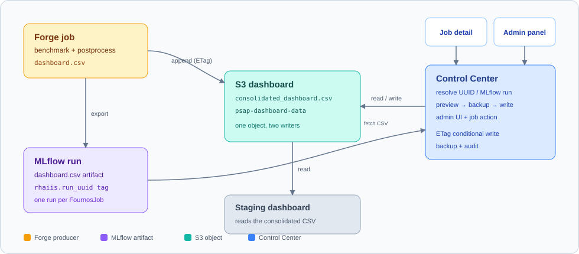
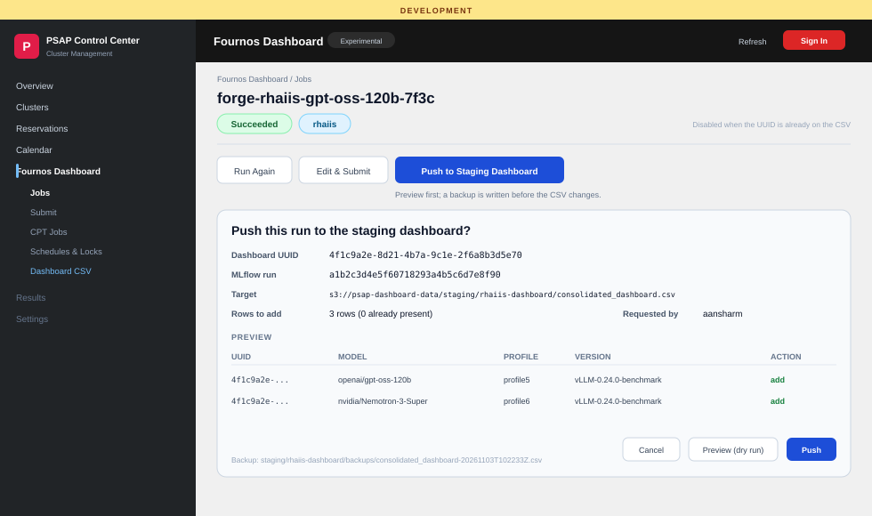
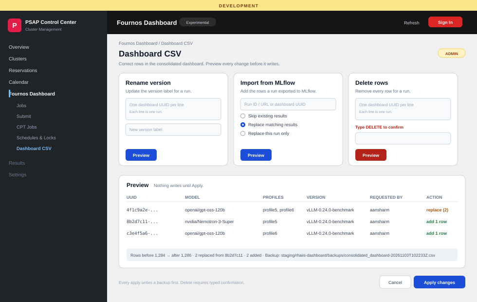

# Dashboard CSV Amendment Plan — Level 1

**Goal:** let Control Center correct the staging dashboard CSV after a run, without hand-editing S3.

**Scope:** three admin operations on `consolidated_dashboard.csv`:

| Operation | Input | What changes |
|---|---|---|
| **Rename version** | One or more dashboard UUIDs + new label | `version` on every row for those UUIDs |
| **Import from MLflow** | MLflow run ID/URL, or a dashboard UUID | Adds the run's rows; skip, replace matching, or replace this run only |
| **Delete rows** | One or more dashboard UUIDs | Removes every row for those UUIDs |

## The vision

Forge produces a per-run `dashboard.csv` and appends it to S3. The same artifact is
exported to MLflow. Control Center reads the CSV, resolves the run, previews the
change, writes a backup, and updates S3. The staging dashboard picks up the change
on its next read.

The same run has different names in each system:

| System | Identifier | Example |
|---|---|---|
| Fournos | Job name | `forge-rhaiis-gpt-oss-120b-7f3c` |
| MLflow | Run ID | `a1b2c3d4e5f60718293a4b5c6d7e8f90` |
| Dashboard | `uuid` | `4f1c9a2e-...` (Forge's `run_uuid`) |

The dashboard `uuid` is the join key. It is not the FournosJob name or the MLflow
run ID; the job carries it as the `rhaiis.run-uuid` annotation and in its status,
so Control Center can resolve it without a new tag.

## What the user sees

### Push a finished job

On a Succeeded RHAIIS job, an admin gets **Push to Staging Dashboard**. The
confirmation shows the dashboard UUID, MLflow run, target S3 key, and exactly how
many rows will be added. If the UUID is already in the CSV, the action is disabled
and points to the correction panel.

### Fix the dashboard across runs

The admin **Dashboard CSV** tab has the three operations side by side. Every
operation is preview-first; the preview shows the rows, the count, and the backup
path. Delete requires typing `DELETE`.

The UUID fields are textareas: paste one dashboard UUID per line, one run per
line. Blank lines are ignored. The preview table shows the signed-in admin as
**Requested by**; the server derives that username from the session, never from
the request body.

**Import modes:** *Skip existing* keeps any row already present for that
version/model/profile (and concurrency) and only appends missing rows. *Replace
matching* removes those existing rows even when they came from a different UUID,
then writes the new UUID's rows. *Replace this run only* removes all rows for the
imported UUID. The default is skip; replace is explicit and previewed, and the
preview names the old UUIDs that will be removed.

One UUID is not one row: a run can cover several profiles, and each profile has
several concurrency points. The preview lists every row, and the **Profiles**
filter narrows the operation. By default every profile in the run/UUID is in
scope.

## How it works

1. **One key.** The CSV `uuid` is `tests.rhaiis.run_uuid`. Live jobs expose it as
   the `rhaiis.run-uuid` annotation; archived jobs keep it in
   `fjob_status...relevantDeployments[].runUUID`.
2. **Two producers, one object.** Forge owns the per-run artifact. Control Center
   owns the consolidated CSV edit.
3. **No lost updates.** Both writers use S3 ETag conditional writes and retry.
   Every Control Center write backs up the CSV first.
4. **No guessing runs.** Control Center resolves the MLflow run from `mlflow_url`
   or the job status. The `rhaiis.run_uuid` MLflow tag is an optional fallback for
   old or incomplete job records; if none resolve, it stops and says what is
   missing.
5. **Admin only.** Preview, backup, audit, and typed confirmation for destructive
   actions.

## Who builds what

| Side | Changes |
|---|---|
| **Control Center** | S3 CSV service, MLflow artifact fetch, admin endpoints, job-detail button, Dashboard CSV tab, audit |
| **Forge** | Required: dedupe and conditional write in `sync_csv_to_s3`. Optional: tag runs with `rhaiis.run_uuid` for the fallback lookup. |

## Delivery

| Step | Outcome |
|---|---|
| 0 | Forge safe append (optional UUID tag) |
| 1 | Control Center backend: CSV service + MLflow fetch + tests |
| 2 | Control Center API: preview, rename, import, delete, audit |
| 3 | Control Center UI: job button + admin tab |
| 4 | Deployment secret + dry-run + rollback runbook |

## Decisions needed

- **S3 write credentials in Control Center:** yes, or fall back to a Forge batch
  job?
- **Import default:** skip existing rows (recommended) or replace?
- **Placement:** admin tab under Fournos Dashboard (recommended) or Settings?

The detailed API, algorithms, file map, and test plan are in
[Level 2](dashboard-csv-amendment-plan-detailed.md).
