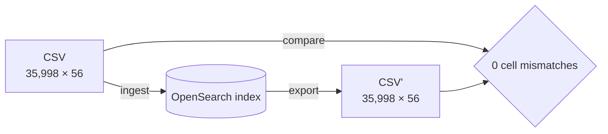

# Benchmark storage decision: CSV vs OpenSearch vs Postgres

Team-facing summary of the storage evaluation for the PSAP benchmark dashboard.
The detailed research, prototype scripts, and raw measurements are in
[`csv-opensearch-research.md`](csv-opensearch-research.md) and
[`../prototype/`](../prototype/).

**Decision requested:** choose the system of record for benchmark metadata.

---

## 1. Why not CSV

Already agreed; listed here for completeness.

- **Lost updates.** Forge downloads the whole 30 MB CSV, appends rows, and
  re-uploads it. Two jobs finishing together overwrite each other — observed by
  Sai on 2026-11-03.
- **No dedupe.** Duplicate rows accumulate (~7,700 surplus, an upper bound) with
  nothing to catch them.
- **Manual edits.** Renaming versions, importing MLflow rows, and deleting
  duplicates require downloading the CSV, editing 10k+ rows in Sheets, and
  re-uploading.
- **Silent corruption.** Positional backfills have written values into the wrong
  columns; adding or reordering fields breaks the file.
- **No transactions or validation.** A failed edit leaves no rollback and no
  record of what changed.

CSV is the baseline, not a candidate.

## 2. Why not OpenSearch

We built a local OpenSearch 3.9.0 + Dashboards 3.9.0 instance and tested it
against the **current staging CSV**: 35,998 rows × 56 columns, plus the llm-d
CSV (454 rows × 53 columns). Prototype scripts are in
[`../prototype/`](../prototype/).

### What worked

OpenSearch can store and query this data. Measured results:

- 35,998 documents ingested in ~5 s; **CSV round-trip** — ingest every row,
  export every document, compare cell by cell — with **0 cell mismatches**.
- The Streamlit dashboard and the agent's `load_rhaiis_data()` read the exported
  CSV unchanged.
- Rename version by UUID: 5 rows updated in ~113 ms via `_update_by_query` with
  a script (`ctx._source.version = params.version`).
- Per-run `dashboard.csv` bulk-ingested in ~30 ms; redelivery is idempotent.
- Discover gives a usable ad-hoc table with saved searches and CSV export.

Round-trip check:

So the objection is not "OpenSearch cannot do it." It is that the operations we
care about become harder — a rename is an `_update_by_query` script, "replace a
run" is delete-then-insert, and a partial failure cannot roll back — and we take
on a new system to operate.

### Pain points found during setup and testing

**1. You still design and maintain a schema.**

- Mappings are mandatory, and field types can't change in place: changing
  `version` from keyword to text was rejected and needs a new index + reindex.

**2. No multi-row transactions.**

- The APIs work: we deleted 4 rows and renamed 5 in the prototype. The gap is
  **atomicity**, not capability.
- `update_by_query`, `delete_by_query`, and bulk are not atomic across
  documents; a rename that dies after 3 of 5 rows leaves 3 on the new version
  and 2 on the old.
- SQL `DELETE` is unsupported in OpenSearch 3.x.
- "Replace a run" is delete-then-insert, two operations with a window in
  between; this is the biggest gap for the issue #94 operations.

**3. Multi-project bookkeeping is comparable, not better.**

- Index per project + alias works, but shared fields must have identical
  mapping types; cross-index aggregations fail at query time otherwise.
- Adding a project means create index + mapping + alias action. Postgres needs
  create table + update view. The bookkeeping is comparable.

**4. The UI is for exploring, not editing.**

- Discover, filters, saved searches, and saved objects work well for looking at
  data.
- It is read/explore, not a replacement for editing rows.

**5. New operational surface.**

- Cluster, shards/replicas, mappings, reindex runbook, Dashboards saved objects,
  snapshots, tenant/access management.
- A lab instance exists, but there is no integration, mapping ownership, or
  reindex runbook yet.

**6. Capabilities we do not use.**

- Relevance ranking, analyzers, fuzzy matching, synonyms, highlighting.
- SQL/PPL support is limited; there are no joins (not needed here).
- We would pay for a search engine while using it as a table.

## 3. Why Postgres

Postgres matches the operations the team actually performs.

- **Transactions for corrections.** Rename by UUID, replace a run, and delete by
  UUID + profile are `BEGIN … COMMIT`. All rows change or none do; a crash rolls
  back cleanly.
- **SQL + `ILIKE`.** Substring matching on model/version works the way the team
  expects; the team already leans SQL.
- **Schema handling.** Stable columns stay typed; drifting or modality-specific
  fields go in `JSONB`. `ADD COLUMN` is cheap; `ALTER COLUMN TYPE` is one
  migration, not a reindex.
- **Multi-project.** Table per project plus a `UNION ALL` view. Explicit,
  type-checked, and comparable to an index + alias.
- **Write path.** `INSERT … ON CONFLICT` per row fixes the race and gives a
  transactional batch per run.
- **Operations.** Already deployed for agent state
  (`openshift-manifests/02-postgresql.yaml`); backups and operations are known.

### What Postgres does not solve

- **Not yet prototyped.** Postgres claims here are standard behavior plus the
  existing deployment, not a local benchmark. The 1–2 day bake-off on the same
  corpus is the first next step.
- **Sparse fields need `JSONB` discipline.** Modality-only fields (image
  resolution, audio duration) go in a `JSONB` column; adding keys is easy, but
  key names and types are by convention and queried keys need GIN indexes.

## 4. Scorecard

Confidence levels:

- **High** — measured on the actual corpus in the prototype, or unambiguous,
  well-documented behavior.
- **Medium** — standard behavior, but not tested on our corpus or deployment.
- **Low** — forward-looking; depends on requirements we do not have today.

| What we need | CSV | OpenSearch | Postgres | Winner | Confidence | Basis |
|---|---|---|---|---|---|---|
| Concurrent writes without lost updates | No | Yes, per document | Yes, per row; transactional batches | **Postgres** (OpenSearch ties on the race) | High | OpenSearch measured; Postgres standard |
| Rename / replace / delete a run atomically | No | No; non-atomic across documents | Yes, one transaction | **Postgres** | High | OpenSearch measured; Postgres ACID standard |
| Add a column | Fragile | Easy: `PUT _mapping` | Easy: `ADD COLUMN` | **Tie** | High | OpenSearch measured; Postgres standard |
| Change a column type | Hand-edit | New index + reindex + alias swap | One `ALTER` | **Postgres** | High | OpenSearch measured; Postgres standard |
| Cross-project queries | No | Index per project + alias | Table per project + view | **Tie** | Medium | OpenSearch measured; Postgres view not built |
| Sparse / per-modality fields | Breaks | Natural sparse documents | `JSONB` | **Slight OpenSearch** or tie | Medium | OpenSearch measured; Postgres JSONB standard |
| Ad-hoc browsing | Sheets (familiar, risky) | Discover + saved searches | Needs an external tool | **OpenSearch** | High | OpenSearch used |
| Operational burden | Low but fragile | New cluster, mappings, reindex runbook | Already deployed | **Postgres** | Medium | Existing deployment; no lab OpenSearch integration |
| Team familiarity | High | Low (one expert) | Medium-High (SQL) | **Postgres** | High | Team discussion |
| Full-text / fuzzy search | No | Native strength | Weaker (`pg_trgm`) | **OpenSearch** | High | Not a current requirement; low relevance today |
| Scale at current volume | Fine | Fine | Fine | **Tie** (not a differentiator) | High | 100–2,000 rows/month; 36k today |
